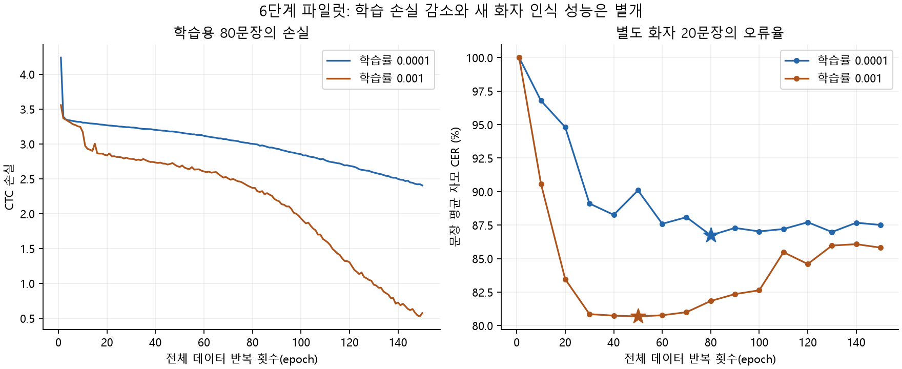

# 6단계 — 파일럿 본 학습과 별도 화자 성능 검증

실행일: 2026-09-17 / RTX 3080 10GB / `lipnet-compact-v1`.

**두 설정에서 실제 학습과 평가를 완료했지만, 웹캠 문장 인식에 사용할 성능은 확보하지 못했다.**
가장 낮은 개발 검증 오류율은 자모 CER **80.68%**, 완전히 맞힌 문장은 **0/20개**였다.
학습용 문장의 오류율을 낮추는 것은 가능했지만 별도 화자의 문장에서는 개선이 이어지지 않았다.

다음에는 **학습 데이터 확대와 학습 방법 개선이 필요하다.** 다만 당장 새 파일을 다운로드하거나
전달할 필요는 없다. 이미 내려받은 원본에서 현재 학습 화자들의 추가 문장 후보 **3,843개**를
확인했고, 다음 실험에서 우선 1,000문장 규모로 확대하는 안을 정리했다.
이 규모는 다음 실험의 시작점이며 성능을 보장하는 기준은 아니다.

## 1. 사용 데이터와 실험 방법

기존 `aihub_pilot_v2` 명세를 그대로 사용했다.

| 구분 | 화자 | 문장 | 이번 단계에서 사용한 목적 |
|---|---:|---:|---|
| train | 8명 | 80개 | 가중치 학습, 학습셋에 대한 사후 평가 |
| val | 2명 | 20개 | 개발 검증, best epoch 및 실험 선택 |
| test | 5명 | 50개 | 추론·모델 선택에 사용하지 않고 보존 |

학습 영상 길이는 합계 **366.44초, 약 6.1분**이다. 화자 구분과 문장 캐시는 바꾸지 않았다.
명세 전체의 캐시 무결성 검사는 유지했으며, test 영상을 모델에 넣어 성능을 계산하지 않았다.
개발 검증의 두 화자는 학습 화자와 다르지만, 이 20문장은 모델 선택에 사용되었으므로
독립된 최종 평가 결과라고 표현하지 않는다.

두 실험 모두 새 무작위 초기화에서 시작했다. 5단계의 네 문장 암기 가중치는 사용하지 않았다.

| 설정 | run01 | run02 |
|---|---:|---:|
| 학습률 | 0.0001 | 0.001 |
| 전체 데이터 반복 | 150 epoch | 150 epoch |
| 묶음 크기 | 2문장 | 2문장 |
| 실제 가중치 갱신 | 6,000회 | 6,000회 |
| AMP overflow에 따른 건너뜀 | 0회 | 0회 |
| 기록된 학습·주기적 검증 시간 | 약 867.6초 | 약 872.7초 |

공통 설정은 Adam, seed42, AMP, CTC FP32, gradient clipping 1.0이다.
모델 구조와 dropout 0.1은 유지했고 데이터 증강이나 언어 모델은 추가하지 않았다.
1 epoch와 이후 10 epoch마다 beam width10으로 val CER를 확인했다.

run02는 run01의 67 epoch까지 학습 손실 감소가 느린 것을 확인한 뒤 추가한 비교 실험이다.
검증셋만으로 설정을 비교했으며 test 결과를 보고 실험을 추가하지 않았다.
두 실행은 같은 GPU에서 일부 시간에 겹쳐 수행되었으므로 실행 시간은 하드웨어 속도 비교로
사용할 수 없다. PyTorch 최대 할당량은 두 실행 모두 약 760.5MiB였다.

## 2. 학습용 문장과 별도 화자의 결과

아래 CER는 **문장별 자모 오류율의 평균**이며, 낮을수록 좋다.
best는 해당 실험에서 val CER가 가장 낮은 epoch이고, last는 150 epoch의 마지막 모델이다.

| 실험·가중치 | epoch | train CER | val CER | train 완전 일치 | val 완전 일치 |
|---|---:|---:|---:|---:|---:|
| run01 best | 80 | 89.04% | 86.73% | 0/80 | 0/20 |
| run01 last | 150 | 80.85% | 87.51% | 0/80 | 0/20 |
| **run02 best — 선정 모델** | **50** | **79.03%** | **80.68%** | **0/80** | **0/20** |
| run02 last | 150 | 15.99% | 85.82% | 13/80 | 0/20 |

run01에서는 학습용 문장도 충분히 익히지 못했다.
run02에서는 마지막 모델의 train CER가 15.99%까지 낮아졌지만 val CER는 85.82%로
높게 남았다. 이는 학습한 자료에 맞추는 과정이 새로운 화자·문장에 대한 개선으로
이어지지 않은 결과이며, 과적합·일반화 부족 양상이 뚜렷하다.
마지막 모델도 train 80문장을 모두 정확하게 익힌 것은 아니다.



**선정 가중치:** `results/step6-pilot/run02/best.pt`, 50 epoch.
이는 두 실험 중 검증 수치가 가장 낮다는 뜻이며, 사용 가능한 웹캠 인식 모델이라는 의미는 아니다.
웹캠 기본 배포 경로 `backend/models/weights/baseline_jamo_v2.pt`에는 연결하지 않았다.

### 오류율을 읽는 방법

선정 모델의 val 결과는 문장 평균 CER **80.68%**, 모든 정답 자모의 총 길이를 분모로 한
전체 CER **80.98%**이다. 전체 어절 WER는 **108.99%**다.
삽입 오류가 있으면 CER/WER가 100%를 넘을 수 있으며, `100%-CER`를 인식 정확도로
단순 환산하지 않는다. 평가 코드의 기존 단순 정확도 환산 출력도 제거했다.

20문장 중 13문장에 잘못된 자모 조합을 나타내는 `�`가 포함되었다.
이는 파일 인코딩이 깨진 표시가 아니라 모델이 초성·중성·종성 순서를 잘못 예측한 것을
삭제하지 않고 드러낸 표시이다. 예측 문자열을 임의로 정리해서 오류율을 낮추지 않았다.
전체 정답·예측은 실험 폴더의 `best_val.json` 등에 저장되어 있다.

## 3. 입력 영상에 대한 대조 검사

두 실험이 끝난 뒤 선정 모델에 대해서만 추가 진단을 했다. 대조 결과는 모델 선택에 사용하지 않았다.
길이와 정답은 유지하고 영상 내용 또는 프레임 순서만 바꿨다.

| val 입력 | 문장 평균 CER | 완전 일치 |
|---|---:|---:|
| 원래 입술 영상 | 80.68% | 0/20 |
| 모든 픽셀을 회색 128로 대체 | 79.15% | 0/20 |
| 프레임 순서를 역순으로 변경 | 80.83% | 0/20 |

회색·역순 입력에서도 오류율이 비슷했다. 작은 표본의 이 차이를 통계적으로 유의한 개선이라고
해석하지 않는다. 다만 현재 모델이 올바른 입술 영상과 시간 순서를 활용해 인식 성능을 높였다는
증거는 부족하다. 빈도 높은 출력이나 영상 길이 등에 의존하는 가능성도 남아 있다.
데이터를 늘리면 반드시 해결된다고 단정할 수 없으며 학습 방법도 함께 점검해야 한다.

## 4. 추가 데이터가 필요한 이유와 확보 범위

현재 train은 여성 8명·정면 영상·80문장이다. 검증 문장의 어절 189개 중 138개는 학습 문장에
동일한 어절로 등장하지 않았다. 자모 종류는 train 60종이며, val에는 학습에서 보지 못한
종성 `ㅊ`(U+11BE)이 1회 있었다. 이것만으로 높은 오류율 전체를 설명할 수는 없지만,
현재 학습 자료의 범위가 좁다는 점은 확인된다.

기존 로컬 원본의 색인을 다시 확인한 결과:

- **기존 train 8명에 해당하는 정면 문장 후보: 총 3,923개.**
- 이 중 현재 사용 중인 80개를 제외한 추가 후보: **3,843개**.
- 관련 녹화 96개, 실제 원본 파일·아카이브 경로 49개와 라벨 96개의 존재를 확인했다. 누락은 없었다.
- 후보는 라벨 조건을 통과한 색인 항목이다. 실제 입술 영역 추출과 영상 대조 검수를 마친 학습 캐시가 아니다.

따라서 **지금 사용자에게 새 파일 전달이나 전체 데이터 재다운로드를 요청할 필요는 없다.**
다음에는 기존 train 화자를 유지하면서 약 1,000문장을 먼저 준비하고 비교하는 것이 구체적인
시작점이다. 기존 데이터셋은 보존하고 새 버전으로 만들며, val/test 화자를 train에 넣지 않는다.
같은 발화·정답의 분할 간 중복, 라벨·영상 정합, 실제 ROI를 다시 검사해야 한다.

새로운 화자에서도 인식하려면 이후에는 현재 8명 이외의 화자, 남성·다양한 연령,
실제 웹캠 촬영 조건과 정답 문장까지 범위를 넓혀야 한다. 이 추가 다운로드나 촬영 자료가
실제로 필요한 단계에서 종류·규모·이유를 먼저 안내한다. 이번 단계에서는 후보 조사만 했고
새 영상을 추출하거나 데이터셋을 변경하지 않았다.

## 5. 코드와 검증

- `scripts/train.py`: epoch별 학습 손실·val CER·샘플·최적 epoch를 기록하고,
  중간 진행 JSON과 best/last 가중치를 따로 보관하도록 보완했다.
- `scripts/test_model.py`: train/val/test를 명시해 평가하고 전체 문장 예측, CER/WER,
  문장 평균/전체 길이 기준 지표, 정답 완전 일치 수, 가중치 해시를 JSON으로 저장한다.
- 회색·역순 영상 대조 평가를 지원한다. 정답은 추론 출력 이후 비교에만 사용한다.
- 평균과 전체 길이 기준 오류율의 차이, 100% 초과 오류율, 정답 비전달,
  best/last 분리 저장과 best 재로드를 자동 검사했다.
- CPU·서버 회귀 검사 **201개 통과**. CUDA 전용 1개는 CPU 환경에서 건너뛰었고,
  기존 MediaPipe 의존 검사 2개는 해당 패키지 미설치로 제외했다.
- GPU 환경의 새 파일럿 평가 검사 **3개 통과**. 실제 GPU 학습은 두 실행에서 총 12,000회 갱신했다.

저장 결과:

- `results/step6-pilot/run01`, `run02`: `experiment.json`, `training.json`, `best.pt`, `last.pt`,
  `best_train.json`, `best_val.json`, `last_train.json`, `last_val.json`, `evaluation_summary.json`.
- `results/step6-pilot/run02/val_controls.json`: 선정 모델의 대조 입력 결과.
- `results/step6-pilot/selected_model.json`: 선택 기준과 선정 가중치 해시.
- `results/step6-pilot/data_audit.json`, `data_expansion_proposal.json`: 로컬 데이터 조사와 확대 제안.
- [6단계 검증 결과 JSON](06_검증결과.json): 학습 곡선 원자료와 문장별 평가 결과를 보관한 문서용 사본.

체크포인트는 추론용으로 optimizer/scaler 상태를 복원하는 학습 재개 기능은 아직 없다.

## 6. 재실행과 다음 단계

프로젝트 루트 PowerShell에서 기존 실험과 겹치지 않는 새 출력 경로를 사용한다.

```powershell
$env:OMP_NUM_THREADS = '2'
$env:MKL_NUM_THREADS = '2'

# run02와 같은 설정으로 새 학습. 원본 실험 폴더를 덮어쓰지 않도록 새 경로 지정
& '.\.venv-gpu\Scripts\python.exe' scripts/train.py --device cuda --precision amp --epochs 150 --batch-size 2 --lr 0.001 --eval-every 10 --seed 42 --out results/step6-pilot/new-run/best.pt --last-out results/step6-pilot/new-run/last.pt --report results/step6-pilot/new-run/training.json

# 저장된 선정 모델의 개발 검증 결과 재확인
& '.\.venv-gpu\Scripts\python.exe' scripts/test_model.py --weights results/step6-pilot/run02/best.pt --split val --device cuda --report results/step6-pilot/run02/val_recheck.json
```

**6단계의 학습·평가 작업은 완료했으나 최종 목표의 인식 성능은 미달이다.**
다음 7단계는 웹캠에 연결하기 전에 기존 원본으로 학습 데이터를 확대하고, 별도 화자에서
실제 영상의 효과가 나타나는지 학습·대조 실험을 반복하는 방향이 적절하다.
최종 test 50문장은 이후 모델·설정이 확정될 때까지 보존한다.
