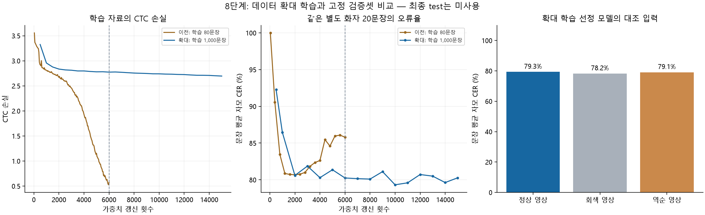

# 8단계 완료: 확대 데이터 학습과 성능 비교

작업일: 2026-09-17

7단계에서 준비한 학습 1,000문장으로 **30회 반복, 14,999번 가중치 갱신**을 완료했다.
총 15,000개 미니배치 중 AMP 수치 보호로 건너뛴 갱신은 1회다.
고정 검증 20문장에서 선정 모델의 문장 평균 자모 오류율은 **79.32%**,
정답 문장 완전 일치는 **0/20**이다.
이전 80문장 학습의 최저 오류율 80.68%와 비교하면
**1.36%포인트 감소**했다. 두 모델은 같은 검증 파일·정답으로 비교했다.
최종 test 50문장과 실제 웹캠의 성능은 이번에 측정하지 않았다.

## 1. 학습 조건과 범위

| 항목 | 실행 값 |
|---|---|
| 데이터 | aihub_expanded_v3, train1,000/val20/test50 |
| 모델 | lipnet-compact-v1, 3,287,781개 변수 |
| 초기화 | 무작위 초기화, seed42 |
| 학습 | Adam, 학습률0.001, batch2, 기울기 누적1 |
| 정밀도 | GPU AMP, log-softmax와 CTC는 FP32 |
| 반복/갱신 | 30epoch / 실제 14,999회, 건너뛴 갱신 1회 |
| 검증 | epoch1 및 2회마다 고정val20, CTC beam10 |
| 중간 비교 | epoch12 가중치 별도 저장, 6,000회 갱신 시점 |
| 최적 모델 | epoch 20, val 문장 평균 자모 CER로 선정 |
| 학습 장치 | NVIDIA GeForce RTX 3080 |
| 학습 및 주기적 검증 시간 | 29.44분, 종료 후 평가·초기 데이터 검사 시간은 별도 |
| PyTorch 최대 할당/예약 메모리 | 762.1/3302.0MiB |

GPU 메모리 수치는 PyTorch의 측정치이며 바탕화면 등 다른 프로그램까지 포함한 전체 사용량은 아니다.
21회차의 한 미니배치에서 비유한 기울기가 발생해 AMP가 갱신을 건너뛰었고, 이후 학습을 정상 완료했다.
기록된 15,000개 손실 값은 모두 유한한 값이다. 생략된 갱신을 성공 횟수에 포함하지 않았다.
이번 학습은 기존 PC에서 완료했으며 새 데이터 다운로드나 Colab 이용은 필요하지 않았다.
6단계와 모델 구조·학습률·batch·seed를 맞췄고, 데이터 규모와 학습 갱신 횟수는 다르다.

## 2. 같은 검증 문장에서의 비교

| 모델 | 문장 평균 CER | 전체 자모 기준 CER | 전체 어절 기준 WER | 문장 완전 일치 |
|---|---:|---:|---:|---:|
| 이전 80문장 학습, 선정 모델 | 80.68% | 80.98% | 108.99% | 0/20 |
| 확대 1,000문장 학습, 선정 모델 | 79.32% | 79.81% | 99.47% | 0/20 |
| 확대 학습, 마지막 모델 | 80.28% | 80.32% | 100.00% | 0/20 |
| 확대 학습, 12회/6,000갱신 모델 | 80.25% | 80.69% | 99.47% | 0/20 |

CER/WER는 오류율이며 100%를 초과할 수 있다. 1-CER를 인식 정확도로 환산하지 않는다.
6,000갱신 시점끼리 비교하면 이전 마지막 모델의 val CER는
85.82%, 이번 epoch12는 80.25%다.
같은 갱신 횟수는 같은 고유 문장 수나 정확히 같은 연산량을 뜻하지 않는다.
30회 학습의 최적 모델과 이전 최적 모델은 학습량이 다르므로 결과 차이 전부를 데이터 확대 효과로 단정하지 않는다.

검증 문장별로 이전 선정 모델보다 나아진 문장은 10개,
나빠진 문장은 4개, 같은 문장은 6개였다.
검증은 2명·20문장으로 작고 모델 선정에도 사용했다. 독립된 최종 일반화 점수로 해석하지 않는다.

| 검증 화자 | 선정 모델의 문장 평균 CER | 문장 완전 일치 |
|---|---:|---:|
| C025 | 79.43% | 0/10 |
| C294 | 79.21% | 0/10 |

학습 1,000문장 전체에서도 별도로 추론했다. 선정 모델의 train CER는
79.55%, 완전 일치는 0/1,000이다.
마지막 모델은 train CER 79.39%, val CER 80.28%다.
학습 문장의 점수는 새 화자 성능이 아니다. 기존 train80에 해당하는 부분 결과도 별도로 저장했다.

선정 모델의 검증 출력 중 유효하게 조합되지 않은 자모가 포함된 문장은
7/20개다. 예를 들어 정답이 “아주 기쁘고 감사해”인 영상에서
“아사아거기 았어”로 출력했다. 이러한 실제 출력도 일상 대화의 자막으로 사용할 수 없다는 판단의 근거다.



## 3. 입술 영상 활용 여부의 대조 검사

선정 모델에 같은 검증 20문장을 넣되, 길이와 정답을 유지한 채 영상만 바꿨다.

| 입력 | 문장 평균 CER | 완전 일치 |
|---|---:|---:|
| 정상 영상 | 79.32% | 0/20 |
| 동일 길이의 회색 영상 | 78.25% | 0/20 |
| 프레임 역순 영상 | 79.11% | 0/20 |

이 검사는 영상 내용과 시간 순서의 활용을 점검하는 진단이다. 소수 검증셋에서의 차이를
통계적 유의성이나 실제 웹캠 성능으로 확대 해석하지 않는다.
구체적인 해석과 다음 작업은 아래 결론에 정리한다.

## 4. 저장·재로드와 검증

- 별도의 새 실험 폴더 `results/step8-expanded/run01`에 best·last·epoch12 가중치를 저장했다.
- epoch별 갱신 횟수와 중간 저장 모델의 출처를 기록하도록 학습 코드를 보완했다.
- 12회 시점에서 영상 처리 CNN·특징 투영·LSTM·출력층 모두 초기값 대비 가중치 변화를 확인했다.
  가중치 변화 자체가 유용한 입술 특징 학습을 입증하는 것은 아니다.
- 중간 저장의 범위 오류·기존 파일·best/last 경로 충돌을 학습 시작 전에 거부한다.
- 선정 모델을 GPU에 재로드해 학습 중 기록한 최저 검증 CER와 같은 값을 확인했다.
- CPU 환경에서 재로드한 검증 20문장 중 GPU와 예측이 같은 문장은 **20/20**이다.
  이는 캐시 영상의 추론 검사이며 실제 카메라 촬영 검사가 아니다.
- CPU 회귀 검사 217개 통과, CUDA 전용 1개 건너뜀, MediaPipe 의존2개 제외.
- GPU 환경의 학습·평가 저장 관련 검사7개 통과. 실제 GPU 학습에서 14,999회 갱신을 확인했다.
- 기존 데이터 명세·가중치와 test50은 보존했다. 새 모델을 웹캠용 배포 경로로 복사하지 않았다.

저장된 체크포인트는 추론용이다. 중간 저장도 optimizer/scaler 상태를 포함하는 학습 재개 파일은 아니다.

- 학습 명세 SHA-256: `c89f0fbc870fe60e1ad8e29d7a38ccee2310021958c5b930771371e8ec68f0c4`
- 선정 가중치 SHA-256: `38252d43a42df817a8933d9ac5da7ee5bc6b3e78d923006093670375e44ce9fe`
- 전체 기록: [8단계 검증 결과 JSON](08_검증결과.json)
- 실험 폴더: `results/step8-expanded/run01`, 비교 결과: `results/step8-expanded/comparison.json`

## 5. 재현 방법

프로젝트 루트에서 기존 결과와 다른 새 출력 경로를 지정한다. 다음은 같은 설정의 실행 예시다.

```powershell
$env:OMP_NUM_THREADS = '2'
$env:MKL_NUM_THREADS = '2'
& '.\.venv-gpu\Scripts\python.exe' scripts/train.py --manifest data_cache/datasets/aihub_expanded_v3/manifest.json --device cuda --precision amp --epochs 30 --batch-size 2 --lr 0.001 --eval-every 2 --seed 42 --snapshot-epochs 12 --out results/step8-expanded/new-run/best.pt --last-out results/step8-expanded/new-run/last.pt --report results/step8-expanded/new-run/training.json

# 이미 저장한 선정 모델의 개발 검증. 보고서 출력은 새 경로로 지정한다.
& '.\.venv-gpu\Scripts\python.exe' scripts/test_model.py --manifest data_cache/datasets/aihub_expanded_v3/manifest.json --weights results/step8-expanded/run01/best.pt --split val --device cuda --report results/step8-expanded/recheck.json
```

`--control constant_gray` 또는 `--control reversed`를 추가하면 같은 대조 입력을 평가할 수 있다.
최종 test50은 모델·설정을 확정하기 전 평가하지 않는다.

## 6. 결론과 다음 단계

**8단계의 확대 학습·비교는 완료했지만, 웹캠 립리딩 프로그램의 인식 성능은 확보하지 못했다.**
이번 조건에서 데이터 확대 후 검증 오류율이 조금 줄었으나, 정상 영상이 회색 영상보다 더 좋지 않았다.
따라서 유용한 입술 특징을 읽어 성능이 개선되었다고 결론 내릴 수 없다.
학습 문장에서도 높은 오류가 남으므로, 단순히 더 많은 문장을 넣거나 검증 문장에 맞춰 출력 문구를
보정하기보다 영상 특징 학습과 학습 조건을 확인해야 한다. 현재 결과만으로 특정 원인 하나를 확정하지 않는다.

**다음 9단계의 범위는 성능 정체 원인 확인과 모델·학습 방식 개선**으로 제안한다.

1. 기존 train에서 짧은 문장 16~32개를 사전에 고정해 학습 연결을 더 넓게 점검한다.
   영상·정답 시간 구간과 특징 변화를 확인하고 정상/회색/역순 입력에서 실제 출력이 어떻게 달라지는지 기록한다.
   이는 학습용 진단이며 새 화자 인식 성과로 보고하지 않는다.
2. 진단을 바탕으로 설계서의 다음 후보인 3D-ResNet 기반 시각 특징 추출기를 우선 검토한다.
   후보 하나씩 기존 경량 모델과 같은 v3 데이터·검증 기준으로 비교하고, 학습률·학습량도 함께 기록한다.
   구조를 바꾸기 전에 GPU 메모리와 역전파를 확인하고, 성능이 좋아질 것이라고 미리 보장하지 않는다.
3. 학습 오류 감소와 정상 영상의 대조 입력 대비 이점이 나타나는지 확인한 뒤 고정 val20의 결과를 비교한다.
   val은 2명뿐이며 반복적인 모델 선택에 사용했으므로 이 점수만으로 최종 일반화를 판단하지 않는다.
   모델·설정이 확정된 이후 test50을 평가하고, 그 뒤 실제 웹캠의 크롭 분포·인식 결과·지연을 측정한다.

**지금 사용자에게 새 학습 데이터 전달이나 다운로드를 요청할 필요는 없다.**
다음 단계의 초기 진단은 이미 준비된 train1,000으로 가능하다. 장기적으로 다양한 사람의 자유 발화를
인식하려면 화자와 촬영 조건의 다양성도 확대해야 한다. 추가 자료가 실제로 필요해지는 단계에서
종류·규모·이유를 먼저 알리고, 기존 val/test 화자는 학습에 편입하지 않는다.

## 7. 후속 개선 검토의 참고 근거

원래 LipNet 논문은 제한된 6단어 문법의 GRID 자료와 입 중심 정렬·데이터 증강을 사용했다.
따라서 논문의 점수를 이 프로젝트의 한국어 문장·별도 화자 성능으로 옮겨 적용할 수 없다.
현재 경량 CNN+BiLSTM 모델도 원논문의 구조·학습 조건과 다르다.
참고: [LipNet 원논문, 데이터·전처리·평가](https://arxiv.org/pdf/1611.01599).

사전학습한 시각 음성 표현을 활용하는 접근도 후속 비교 대상이다. AV-HuBERT의 공식 배포에는
시각 음성인식용 사전학습·미세조정 모델이 구분되어 있다.
한국어 토큰·입력 전처리·실행 환경과의 호환성을 확인하는 별도 실험이 필요하며,
이번 단계에서는 해당 모델을 다운로드하거나 적용하지 않았다.
참고: [AV-HuBERT 공식 모델 자료](https://facebookresearch.github.io/av_hubert/).
