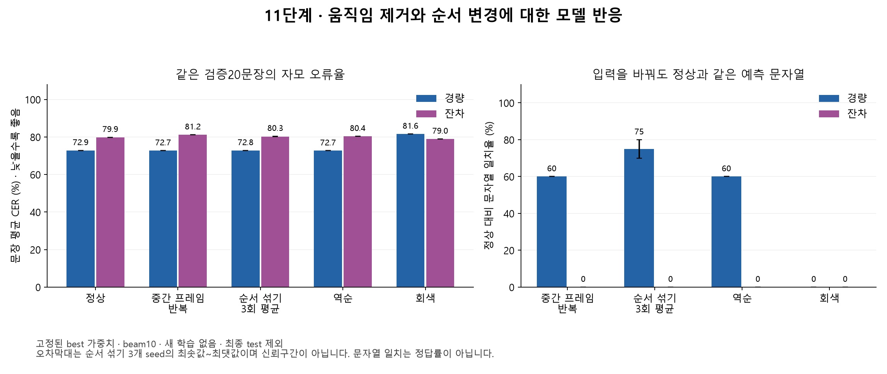

**11단계 — 정지 영상·시간 순서 대조와 CTC 출력 진단**

실행·작성일: 2026-09-18. 현재 PC의 RTX 3080에서 고정 가중치 추론을 수행했다.

**경량 모델은 입술 움직임을 없애거나 순서를 바꿔도 비슷한 반복 출력을 유지했다. 잔차 모델은 입력 변화에 반응했지만 정확한 발화 복원으로 이어지지 않았다. 두 모델 모두 일부 자모에 출력이 집중되어 있었다.**

이번 단계는 새 학습이나 정확도 개선 단계가 아니다. 정상 영상의 성능은 기존 9·10단계와 동일하다. 단일 오류나 특정 층을 실패 원인으로 확정한 것도 아니다. 입력 대조, 출력 편중, 학습 전후의 복원 차이를 확인하여 다음 학습 실험에서 확인할 가설을 좁혔다.

**실험 범위와 비교 방법**

- 본학습 모델: 9단계 경량 best(epoch6), 10단계 잔차 best(epoch20). 기존 정상 val로 선정한 가중치를 고정했으며 새로 선택하지 않았다.
- 선행 학습 모델: 같은 v4 train16을 1,600회 갱신한 경량·잔차 가중치. 이16문장에서만 별도로 검사했다.
- 정상 입력: 두 본학습 모델 각각 train1,000/val20 전체를 다시 추론했다. 기존 예측 문자열과 각각 **1,020/1,020개** 일치했다.
- 대조 입력: val20 전체, train의 화자×50프레임 길이 구간별 사전 선정60개, 선행16개. 학습 표본의 합집합은73개이며 두 집단이3개 겹치므로 합산하지 않는다. C293·C312에는50프레임 이하 문장이 없어30개 조합에서2개씩 선정했다.
- 조건: 정상, 중간 프레임(T//2) 반복, 순서 섞기 seed42·137·2026, 역순, 회색128. 모든 조건은 원래 길이T와 정답을 유지했다. 섞기 순열은 표본ID·seed에서 생성하여 두 모델에 동일하게 적용했다.
- 모델은 eval·FP32·batch1·실제 길이로 실행했고 beam10과 greedy를 함께 기록했다. 후크는 모델 출력을 수정하지 않는다.
- 총 추론 수: 본학습 각1,578회, 선행학습 각112회, 합계 **3,380회**. 픽셀 자체의 변화는 같은93클립×7조건=651행에서 별도로 검사했다.
- 최종 test50은 추론·모델 선택에 사용하지 않았다. 추가 다운로드, 모델 학습, 가중치 교체, 웹캠 배포는 하지 않았다.

문장 평균 자모 CER는 낮을수록 좋으며, 100−CER를 인식 정확도로 바꾸지 않는다. 검증20문장은 이미 개발에 사용한2명의 자료로 독립된 최종 평가가 아니다. 섞기3회의 범위는 같은 문장에 적용한3개 순열의 범위이며 신뢰구간도60개의 독립 표본도 아니다.

**검증20문장의 입력 대조**

| 입력 | 경량 CER | 잔차 CER | 경량: 정상과 같은 출력 | 잔차: 정상과 같은 출력 |
| --- | --- | --- | --- | --- |
| 정상 | 72.85% | 79.87% | 20/20 | 20/20 |
| 중간 프레임 반복 | 72.74% | 81.20% | 12/20 | 0/20 |
| 순서 섞기 seed42 | 72.73% | 80.18% | 16/20 | 0/20 |
| 순서 섞기 seed137 | 72.83% | 80.17% | 14/20 | 0/20 |
| 순서 섞기 seed2026 | 72.74% | 80.42% | 15/20 | 0/20 |
| 역순 | 72.68% | 80.39% | 12/20 | 0/20 |
| 회색128 | 81.62% | 78.96% | 0/20 | 0/20 |

모든 검증 조건에서 문장 완전 일치는 두 모델 모두0/20이다. ‘정상과 같은 출력’은 정답 일치가 아니라 입력을 바꿨는데도 예측 문자열이 그대로였다는 뜻이다.

경량은 정상72.85%, 정지72.74%, 섞기 평균72.77%(72.73~72.83%)로 비슷하다. 정지에서12/20, 섞기에서14~16/20의 예측이 정상과 완전히 같았다. 이 표본에서는 정상 시간 순서가 유용한 발화 복원으로 이어지는 이점을 확인하지 못했다.

잔차는 정상79.87%, 정지81.20%, 섞기 평균80.26%(80.17~80.42%)로 대조에서 조금 나빠졌다. 그러나 대조의 예측 문자열은 정상과 모두 달랐다. 따라서 잔차도 경량처럼 입력에 반응하지 않는다고 해석하면 틀리다. **잔차는 입력에 반응하지만 대부분 다른 오답을 내는 상태**이다. 회색은78.96%로 정상보다 오류율이 낮아, 반응 자체가 유효한 발화 해독을 뜻하지 않음도 확인된다.

검증 명세의 첫 문장인 ‘아주 기쁘고 감사해’에서 경량은 정상·정지·섞기3회·역순 모두 ‘아자으 아으 아어’를 출력했다. 잔차는 정상 ‘이자 이 서 사가 었어’, 정지 ‘이자 이 가가 있어’, 섞기42 ‘이자 이� 사가 었어’로 바뀌었지만 정답을 복원하지 못했다. 이 예시는 성능을 보고 고른 문장이 아니라 명세의 첫 문장이다.



**학습 화자·길이 층화60문장의 대조**

| 모델 | 입력 | CER | 완전 일치 | 정상과 같은 출력 |
| --- | --- | --- | --- | --- |
| 경량 | 정상 | 74.08% | 0/60 | 60/60 |
| 경량 | 중간 프레임 반복 | 74.13% | 0/60 | 40/60 |
| 경량 | 순서 섞기 seed42 | 74.20% | 0/60 | 42/60 |
| 경량 | 회색128 | 81.83% | 0/60 | 0/60 |
| 잔차 | 정상 | 79.50% | 0/60 | 60/60 |
| 잔차 | 중간 프레임 반복 | 81.83% | 0/60 | 3/60 |
| 잔차 | 순서 섞기 seed42 | 81.35% | 0/60 | 2/60 |
| 잔차 | 회색128 | 78.94% | 0/60 | 0/60 |

층화60개는 화자·길이별 진단 표본이다. 전체 학습1,000개를 대표하는 가중 평균 점수로 해석하지 않는다. 경량은 학습 표본에서도 정지40/60, 섞기42의42/60에서 정상과 같은 출력을 냈다. 따라서 현재 문제를 새 화자에 대한 일반화 실패만으로 설명하기 어렵다. 모든seed와 역순의 상세 수치는 검증 JSON에 보존했다.

**학습1,000문장 정상 입력의 CTC 출력**

| 모델 | beam CER | greedy CER | blank 평균확률 | blank argmax 비율 | 정답 토큰 수 평균 | greedy 토큰 수 평균 | beam NFD 길이 평균 | greedy 3토큰 반복률 |
| --- | --- | --- | --- | --- | --- | --- | --- | --- |
| 경량 | 73.23% | 73.25% | 46.52% | 59.81% | 65.23 | 45.33 | 45.45 | 72.75% |
| 잔차 | 80.96% | 81.43% | 41.02% | 64.04% | 65.23 | 39.26 | 40.42 | 62.73% |

정답의 nonblank 토큰은63종이었다. CTC 반복 접기 후 greedy 출력은 경량12종, 잔차28종이었다. 경량의 초성ㅇ·중성ㅏ·띄어쓰기·중성ㅡ가 전체 nonblank 출력의95.92%를 차지했고, 잔차의 초성ㅇ·중성ㅏ·중성ㅣ·중성ㅓ가94.39%를 차지했다.

blank 평균확률과 blank가 가장 큰 프레임의 비율은 서로 다른 지표다. 위 수치는 문장별 비율의 평균이며 모든 프레임을 한꺼번에 합친 비율과도 다르다. 현재는 전부blank 또는 빈 문자열만 나오는 실패가 아니다. **다양한 정답 자모를 구분하지 못하고 일부 자모를 반복하는 출력 편중**이 더 정확한 관찰이다.

greedy와 beam 오류율도 각각73.25/73.23%, 81.43/80.96%로 모두 높다. 디코더 선택만 바꾸면 문제가 해결된다고 볼 근거가 없다. 이는 모든 디코딩 방법의 가능성을 배제하는 결론은 아니다.

3토큰 반복률은 겹치는 연속3개 토큰 창에서 `(전체 창 수−고유 창 수)/전체 창 수`이다. 반복을 실제 발화의 정당한 반복과 구분하는 언어학적 지표는 아니며, 출력이3토큰 미만이면0이다. beam 길이는 조합된 문자열의NFD 길이(공백·� 포함)이고 숨겨진 beam 토큰 경로 길이와 다르다. greedy는 CTC 접기 후 원시 토큰 수다.

**길이별 정상 학습 영상 결과**

| 프레임 수 | 문장 수 | 경량 CER | 잔차 CER | 경량 greedy 토큰 수 | 잔차 greedy 토큰 수 |
| --- | --- | --- | --- | --- | --- |
| 001-050 | 33 | 76.08% | 64.12% | 16.27 | 17.73 |
| 051-100 | 395 | 73.15% | 79.62% | 32.32 | 30.68 |
| 101-150 | 400 | 73.14% | 82.41% | 50.15 | 43.69 |
| 151-200 | 172 | 73.08% | 83.89% | 69.56 | 52.81 |

경량은 모든 길이 구간의 CER가 높고, 잔차는 긴 구간에서 더 높다. 다만 길이 구간에는 발음 속도·어휘·화자 차이가 함께 들어 있어 길이 자체의 인과 효과로 해석하지 않는다.

모든 정상 train/val1,020개는 `T≥정답 토큰 수+인접 동일 토큰 쌍 수`를 만족했고 최소 여유는3프레임이었다. 따라서 이번 자료의 단순 CTC 길이 불가능으로 현재 정체를 설명할 수는 없다. 이것이 원전사나 발화 경계의 정확성을 보증하는 것은 아니다.

경량의 영상 길이T와 beam 출력NFD 길이 상관은0.9960, 잔차는0.6283이었다. 경량의 길이에 민감한 반복 출력 가능성을 조사할 근거이지만, 실제 정답 길이도 영상 길이와 관련된다. 상관만으로 ‘영상은 무시하고 길이만 본다’고 확정하지 않는다. 모든 대조가T를 유지한다는 한계도 남아 있다.

**같은16문장: 전체 학습 전후의 복원**

| 모델 | 시점 | 정상 | 정지 | 섞기42 | 섞기137 | 섞기2026 | 역순 | 회색 |
| --- | --- | --- | --- | --- | --- | --- | --- | --- |
| 경량 | 16문장 선행 학습 직후 | 16/16 | 10/16 | 11/16 | 11/16 | 12/16 | 11/16 | 0/16 |
| 경량 | 전체 학습 후 선정 모델 | 0/16 | 0/16 | 0/16 | 0/16 | 0/16 | 0/16 | 0/16 |
| 잔차 | 16문장 선행 학습 직후 | 16/16 | 13/16 | 12/16 | 15/16 | 14/16 | 13/16 | 1/16 |
| 잔차 | 전체 학습 후 선정 모델 | 1/16 | 1/16 | 1/16 | 1/16 | 1/16 | 1/16 | 0/16 |

이 표는 모두 beam10 기준이다. 9단계 문서의 일부 소수문장 대조가greedy였던 것과 혼동하지 않는다.

선행 모델은 정상16/16을 다시 복원했지만 정지 영상에서도 경량10/16·잔차13/16, 섞기에서도11~15/16을 복원했다. **소수문장 암기 성공은 올바른 시간 순서의 학습이나 새로운 발화 인식의 증거가 아니었다.** 정적 모양·화자·문장 길이 등의 단서가 남아 있으므로 각각의 기여는 이 실험만으로 분리할 수 없다.

전체 학습 후에는 같은16문장의 정상 복원이 경량0/16·잔차1/16으로 줄었다. 학습 과정에서 이전 표본의 복원 능력이 유지되지 않았다는 관찰이다. 최적화 불안정, 표본 구성, 자모 분포, 재노출 빈도, 학습량 등 어떤 요인이 원인인지는 아직 분리되지 않았다.

**검증20문장: 정상 대비 특징·출력 변화**

| 모델 | 입력 | CNN 상대RMS | 투영 상대RMS | LSTM 상대RMS | logit 상대RMS | 출력확률 TV |
| --- | --- | --- | --- | --- | --- | --- |
| 경량 | 중간 프레임 반복 | 0.0476 | 0.0325 | 0.0385 | 0.0134 | 0.0266 |
| 경량 | 순서 섞기 seed42 | 0.0396 | 0.0287 | 0.0227 | 0.0079 | 0.0148 |
| 경량 | 회색128 | 1.1863 | 1.1966 | 0.5423 | 0.1984 | 0.3758 |
| 잔차 | 중간 프레임 반복 | 0.2001 | 0.1936 | 0.2206 | 0.1529 | 0.1700 |
| 잔차 | 순서 섞기 seed42 | 0.1843 | 0.1717 | 0.1069 | 0.0427 | 0.0473 |
| 잔차 | 회색128 | 1.1982 | 1.3266 | 0.6451 | 0.4721 | 0.5313 |

CNN은4×4 공간 풀링 후1,536차원, 투영은256차원, LSTM은512차원, logit은69차원이다. `상대RMS=정상 대비 RMS 차이/정상 특징 RMS`이며 같은 모델·같은 단계 안에서 입력 민감도를 설명한다. TV는 같은 시점의 토큰 확률 분포 사이 전체변동거리의 평균으로0~1 범위다.

실제 입력 픽셀도 확인했다. 검증20문장의 ImageNet 정규화 입력에서 정상 대비 상대RMS는 정지0.2042, 섞기0.2076~0.2088, 역순0.2307이었다. 모든 픽셀이 같아서 출력이 같았던 것은 아니다. 경량의 정지/섞기 출력TV는0.0266/0.0148로 작았고 잔차는0.1700/0.0473으로 더 반응했다.

수치의 크기가 층마다 다르므로 ‘CNN에서LSTM으로 정보가몇% 사라졌다’고 계산하지 않는다. 경량에서도 투영→LSTM 변화량이 단조롭게 줄지 않으며, 이 자료로 LSTM 하나를 고장난 층으로 지정할 수 없다. 실제 기울기나 optimizer 상태도 이번 추론에서는 측정하지 않았다.

표는 동일 시간 위치의 비교다. 섞기·역순은 다른 원본 프레임을 비교할 수 있으므로 원본 프레임 위치를 대응시킨 보조 비교도 JSON에 따로 남겼다. 대응시켜도 주변·전체 문맥이 달라지므로 순수한 의미 순서 효과는 아니다. 재배열한 출력으로 정식CER를 계산하지 않았다.

특징 원배열은 저장하지 않았으므로 특징 수치의 사후검사는 해시·형상·유한값·범위 확인과 집계이다. 반면 원시log posterior는 보존하여 CTC·greedy·blank·entropy·대조TV를 다시 계산했다. 별도의 [입력 픽셀 진단](../../results/step11-temporal/run01/input_pixels.json)에는 변환별 픽셀 차이와 불변조건을 보존했다.

**확인한 사실과 남은 가설**

확인한 사실은 경량의 시간 순서 대조에 대한 낮은 민감도, 잔차의 반응과 인식 성능 사이의 차이, 두 모델의 자모 편중, 소수문장 암기와 전체 학습 사이의 복원 저하다. CTC 길이 불가능·전부blank·잘못된 가중치 재사용으로 이번 결과를 설명할 근거는 없다.

아직 확정하지 못한 것은 학습률/optimizer 전환의 영향, gradient 전달 문제, 영상 표현의 충분성, 표본 확대와 자모·길이 분포 변화의 영향이다. 영상 전사·발화 경계의 세부 정합, 화자 다양성, 학습bbox와웹캠ROI 차이도 남은 과제다. 정지·섞기·회색은 원래 자료와 다른 입력이므로 대조 하나로 시각 정보 사용 여부를 완전히 증명할 수 없다.

**다음12단계 계획 — 학습 확대 시점의 출력 편중을 통제 실험으로 추적**

현재 결과에서는 큰 구조나 새 데이터를 곧바로 도입하기보다, 같은 경량 short16 가중치에서 학습을 다시 시작할 때 무엇이 달라지는지 확인하는 것이 우선이다.

1. A군은 원래16문장을 계속 학습하고, B군은 원래16+사전 선정48=64문장을 학습한다. 두 군의 초기 가중치·새Adam·학습률·batch·정밀도·갱신 예산은 같게 둔다. 표본별 재노출 수는 함께 기록한다.
2. 짧은 고정 간격마다 원래16/추가48의 정상 복원·정지/섞기 대조·자모 다양성·반복·blank를 별도로 기록한다. 평가 표본과 중단 기준을 실행 전에 고정한다.
3. AMP unscale 후clip 전의 CNN/투영/LSTM/출력층 gradient norm, clip 계수, 실제 가중치 변화량, scaler·skip·학습률을 기록한다.
4. A도 무너지면 같은 자료에서의 학습 재시작 조건을 우선 조사한다. B에서만 무너지면 자료 확대와 재노출 변화의 영향을 좁히고, 이후에는 한 요인씩 비교한다. 어느 결과도 아직 발생한 사실로 주장하지 않는다.

이 비교도64개의 구성·길이·자모 분포를 한 번에 완전히 분리하지는 못한다. 목적은 진단 범위를 줄이는 것이다. 이번11단계에서는12단계 학습을 실행하지 않았다. 기존 자료로 시작할 수 있으며 추가 자료가 필요해지면 종류·규모·이유를 먼저 안내한다.

**검증과 산출물**

- 진단 변환·runner·집계 관련 자동검사 **58개 통과**. 기존 전체 프로젝트 검사를 다시 실행한 것은 아니다.
- 두 본학습 모델에서 사전 선정한 train 한 클립씩을 사용해 hook on/off log posterior가 완전히 같음을 확인했다.
- 정상train/val 예측은 각1,020개, 기존 회색·역순val 예측은 각20개씩 재현했다. 선행16의 정상beam/greedy 결과도 기존 기록과 일치했다.
- 3,380행의 원시 posterior에서 greedy·blank·entropy·CTC loss·대조 수치를 다시 계산했다. beam은 저장된 문자열을 재사용해CER/WER와 기존 예측을 검증했으며 집계 단계에서 전부 재디코딩하지는 않았다.
- 사용한train/val1,020개 캐시, 가중치, 명세, 실행 소스의 해시를 검사했다. 입력651행의 normal/정지/회색/순열 보존 조건도 확인했다.
- [검증 JSON](11_검증결과.json), [실행 계획](../../results/step11-temporal/run01/plan.json), [완료 기록](../../results/step11-temporal/run01/completed.json)을 보존했다. 문장별행과 원시posterior는각모델결과폴더에있다.
- [진단 실행 코드](../../scripts/diagnose_temporal_use.py), [대조·CTC 계산](../../scripts/temporal_diagnostics.py), [집계 검증](../../scripts/summarize_temporal_diagnostics.py), [입력 픽셀 검사](../../scripts/inspect_temporal_inputs.py)를 추가했다.

재실행은 기존 결과를 덮지 않는 새 경로를 사용한다.

```powershell
$env:OMP_NUM_THREADS='2'
$env:MKL_NUM_THREADS='2'
& '.\.venv-gpu\Scripts\python.exe' scripts/diagnose_temporal_use.py --out results/step11-temporal/new-run
& '.\.venv-gpu\Scripts\python.exe' scripts/inspect_temporal_inputs.py --run results/step11-temporal/new-run
& '.\.venv-gpu\Scripts\python.exe' scripts/summarize_temporal_diagnostics.py --run results/step11-temporal/new-run --out results/step11-temporal/new-run/summary.json
```

검증표의 근거 명세 SHA-256: `214ce935150b367a15f24f0896901d34c54c6d4fe73d493a9d397c4c94fe59a6`.
