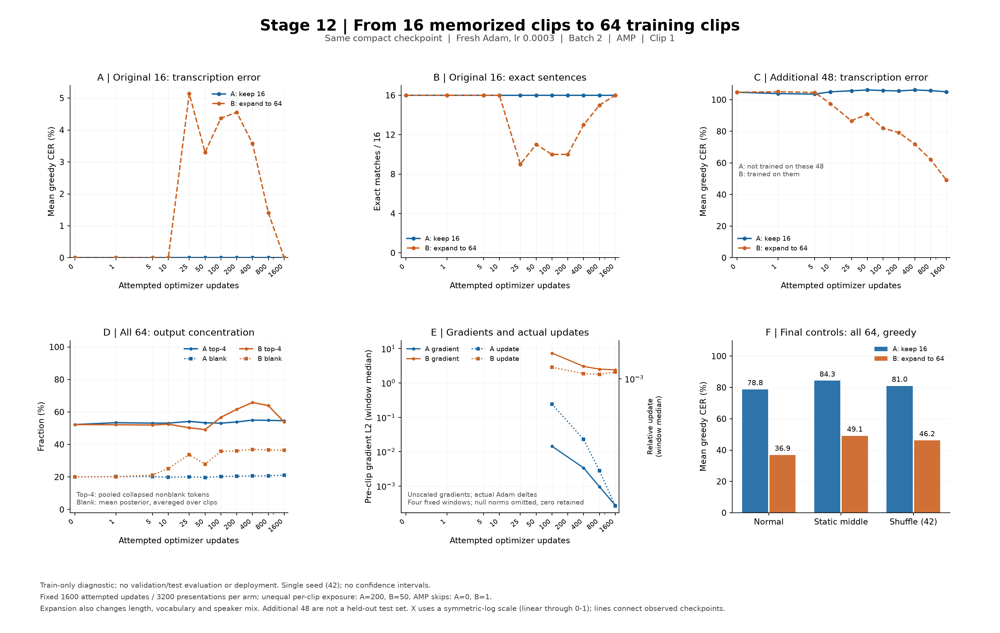

# 12단계 — 16문장 유지와 64문장 확대 학습의 전환 진단

2026-09-18, 계획한 두 실험과 결과 검증을 완료했다. **16문장 유지군은 모든 관측점에서 기존 문장을 복원했고, 64문장 확대군은 초기에 일부 문장을 잊었다가 최종 16/16로 회복했다.** 추가 48문장의 오류율도 내려갔다. 이번 64문장 실험의 최종 시점에서는 이전 1,000문장 본학습 가중치에서 확인했던 기존 문장 복원 실패가 나타나지 않았다.

그렇다고 문제가 해결된 것은 아니다. 확대군이 학습한 추가 48문장의 완전 일치는 아직 4/48, 문장 평균 자모 CER는 49.23%다. 학습량 부족 가능성을 더 확인할 근거가 생겼으며, 웹캠이나 새 화자에 대한 성능은 아직 확인하지 않았다. 추가 데이터 다운로드는 이번 단계에 필요하지 않았다.

**핵심 결과 — 정상 영상, 마지막 1,600회 시점**

| 평가 집단 | 시작점 greedy CER / 완전 일치 | A: 16문장 유지 | B: 64문장 확대 |
| --- | --- | --- | --- |
| 기존 16문장 | 0.00% / 16/16 | 0.00% / 16/16 | 0.00% / 16/16 |
| 추가 48문장 | 104.72% / 0/48 | 105.04% / 0/48 | 49.23% / 4/48 |

beam10으로도 최종 기존 16개는 두 군 모두 16/16이다. 추가 48개는 A 105.02%·0/48, B 49.53%·4/48이다. greedy와 beam을 구분했으며, CER는 오류율이라 삽입 오류가 많으면 100%를 넘을 수 있다. `1−CER`를 인식 정확도로 환산하지 않는다.

추가 48개는 A가 학습하지 않은 표본이고 B가 학습한 표본이다. 위 차이는 새로운 화자나 외부 시험 자료에서의 일반화 우위를 뜻하지 않는다.



그래프의 시간축은 초반 변화를 보기 위한 symlog 축이며 점 사이의 선은 관측점 연결이다. D/F 패널의 전체64는 16/48의 표본 수로 가중한 집계다. 상위4 토큰 비중은 두 집단의 토큰 빈도를 합친 뒤 다시 계산했다. E 패널은 고정 구간의 중앙값이고 오른쪽 축은 실제 가중치의 상대 변화량이다.

**이 실험을 진행한 이유**

11단계에서는 소수 16문장을 모두 복원했던 경량 모델이 1,000문장 본 학습 후 같은 문장을 복원하지 못했고, 출력이 일부 자모에 편중되는 현상을 확인했다. 그러나 고정된 가중치의 추론만으로는 그 현상이 언제 생겼는지, 실제 기울기와 가중치 갱신에 문제가 있었는지 알 수 없었다.

12단계는 같은 16문장 학습 가중치에서 다시 시작해 A군은 원래 16문장만, B군은 원래 16문장과 추가 48문장을 학습한다. 원래 문장의 복원 유지, 추가 문장의 습득, 출력 편중 및 학습 과정의 수치 상태를 함께 추적한다. 최종목표인 웹캠 입술 영상의 문장 추출을 위한 학습 정체 진단이며, 실제 웹캠 성능 평가가 아니다.

**실행 전에 고정한 조건**

| 항목 | A — 16문장 유지 | B — 64문장 확대 |
| --- | --- | --- |
| 초기 모델 | 경량 16문장 학습의 1,600회 시점 가중치 | 동일 파일·동일 SHA |
| 학습 표본 | 기존 짧은 16문장 | 기존 16 + 사전 선정 48문장 |
| optimizer | 새 Adam, lr 0.0003, betas 0.9/0.999, eps 1e-8, weight decay 0 | 동일 |
| 예산 | batch 2, 1,600회 갱신 시도, 누적 없음 | 동일 |
| 문장당 계획 노출 | 200회, 200epoch | 50회, 50epoch |
| 학습 정밀도 | AMP FP16 + CTC FP32 | 동일 |
| 기울기 | AMP unscale 후 전체 norm 1로 clipping | 동일 |
| 초기 GradScaler | 1,024 | 동일 |
| seed / 순서 | seed42, 매 epoch 전체 index를 섞은 뒤 2개씩 구성 | 동일 알고리즘 |
| 평가 | train 안의 동일 64개, 원16/추가48 구분 | 동일 |

Adam의 기존 momentum, scaler, RNG를 복구한 재개 학습이 아니라 **저장된 가중치부터 시작한 새 학습**이다. 원래 16문장 학습의 lr는 0.001이었다. 두 군 모두 RNG를 다시 초기화하고, 평가 중에는 RNG와 학습 모드를 보존한다. cuDNN deterministic=True, benchmark=False, TF32=False를 명시했다. seed 한 번의 비교이며 모든 하드웨어·환경에서 비트 단위 재현을 보증하지 않는다.

이번 sampler는 매 epoch 모든 표본의 index를 섞어 배치를 구성한다. 9·10단계 본 학습의 고정된 길이 인접 쌍을 섞는 sampler와 다르다. 따라서 9단계 1,000문장 학습의 정확한 재현 실험으로 해석하지 않는다.

추가 48개는 v4의 train 중 기존 16개를 제외한 화자×50프레임 구간에서 골랐다. 각 구간 내부는 ID의 SHA-256으로 정렬하고, 구간은 고정 seed로 정한 순서에 따라 번갈아 선택했다. 예측·loss·CER는 선정에 사용하지 않았다. val/test는 명세의 분할 무결성만 확인했으며 해당 캐시를 열거나 평가하지 않는다.

**평가와 계측**

- 정상 영상의 FP32 단일 문장 평가: 추가 학습 시도 0, 1, 5, 10, 25, 50, 100, 200, 400, 800, 1,600회.
- 정지 영상과 순서 섞기: 0, 100, 400, 1,600회. 정지는 중간 프레임을 T번 반복하고, 섞기는 ID와 seed42로 고정한 순열을 사용한다. 모든 조건에서 T를 유지한다.
- greedy는 모든 평가에서 사용하고 beam10은 0/1,600회에서만 실제 실행한다. 중간 greedy 결과를 beam 결과로 표시하지 않는다.
- CTC loss는 정답 토큰 수로 나눈 문장 손실의 평균이다. 보고서 CER는 기본적으로 문장 평균 자모 오류율이며 corpus CER는 별도로 구분한다.
- 매 학습 시도마다 CNN/투영/BiLSTM/출력층의 unscale 후 clip 전·후 norm, 없는/0/비유한 기울기, clip 계수, 실제 가중치의 절대·상대 L2 변화, 학습률, scaler 및 skip을 저장한다.
- 학습 기울기가 비유한 경우 clipping을 생략하고 GradScaler가 갱신을 건너뛰도록 한다. 해당 norm은 JSON null과 비유한 개수로 기록한다. 비유한 loss는 오류로 중단한다. CER에 따른 조기 중단이나 best 선택은 없다.

step0는 같은 초기 파일에 대한 공통 평가를 한 번 수행해 두 군이 공유했다. 이후 체크포인트는 고정 시도 횟수마다 보존했다. 총 평가 2,240건과 실제 beam 디코딩 576건을 완료했다. 실제 성공 갱신과 skip에 따른 표본 노출도 완료 기록에서 검증했다.

**확대군에서 처음 달라진 시점**

| 추가 학습 시도 | 기존16 완전 일치 | 기존16 greedy CER | 추가48 완전 일치 | 추가48 greedy CER | 추가48 출력 상위4 토큰 비중 |
| --- | --- | --- | --- | --- | --- |
| 0 | 16/16 | 0.00% | 0/48 | 104.72% | 54.58% |
| 1 | 16/16 | 0.00% | 0/48 | 105.06% | 54.42% |
| 5 | 16/16 | 0.00% | 0/48 | 104.60% | 54.24% |
| 10 | 16/16 | 0.00% | 0/48 | 97.46% | 54.97% |
| 25 | 9/16 | 5.14% | 0/48 | 86.65% | 52.33% |
| 50 | 11/16 | 3.30% | 0/48 | 90.81% | 50.84% |
| 100 | 10/16 | 4.37% | 0/48 | 81.93% | 60.32% |
| 200 | 10/16 | 4.55% | 0/48 | 79.20% | 66.70% |
| 400 | 13/16 | 3.58% | 0/48 | 71.91% | 71.54% |
| 800 | 15/16 | 1.41% | 0/48 | 62.24% | 68.22% |
| 1,600 | 16/16 | 0.00% | 4/48 | 49.23% | 56.72% |

기존 문장 복원 저하는 처음으로 **25회 평가**에서 관찰됐다. 직전 10회 평가에서는 16/16이었다. 관측 사이에 저하됐다 회복했을 가능성도 있으므로 정확한 최초 발생 시점은 알 수 없으며, 25번째 갱신에서 시작됐다고 확정하지 않는다. 9/16이라는 문장 단위 결과와 CER 5.14%를 함께 봐야 한다. 일부 글자가 틀려도 문장 전체는 오답이 되므로, 모든 문장이 알아볼 수 없는 출력으로 바뀌었다는 뜻이 아니다.

이후 기존 문장은 회복했고 추가 문장도 개선됐다. 따라서 이번 조건에서는 일시적인 복원 저하와 새 표본 학습이 함께 진행됐으며, 지속적인 복원 붕괴로 이어지지는 않았다. 다만 최종 기존16의 CTC 손실은 시작 0.00798에서 0.07444로 높아졌다. 같은 문자열을 복원해도 확률 분포나 정답 경로의 확신까지 원상 복구된 것은 아니다.

추가48의 CTC 손실은 7.16387→1.66553으로 내려갔다. 각 분포 자체의 상위4 토큰 비중은 400회에 71.54%까지 증가한 뒤 최종 56.72%로 줄었지만, 정답의 상위4 비중 34.04%보다 높다. 출력 토큰 종류는 39→45종, 정답은 56종이다. 3토큰 반복 창의 문장 평균 비율은 35.40%→21.89%로 줄었다. **일부 자모로 치우치는 현상은 남아 있으나 고정된 출력으로 완전히 멈춘 것은 아니다.** 서로 다른 자료를 평가한 11단계의 본학습 top4 비중과 직접 동일 조건 비교를 하지는 않는다.

**기울기와 실제 가중치 갱신**

| 군 / 시도 구간 | clip 전 전체 gradient norm 중앙값 | 실제 상대 가중치 변화 중앙값 | 실질 clipping 횟수 | skip |
| --- | --- | --- | --- | --- |
| A / 1–100 | 0.014503 | 0.000654 | 0 | 0 |
| A / 101–400 | 0.003397 | 0.000360 | 0 | 0 |
| A / 401–800 | 0.000962 | 0.000212 | 0 | 0 |
| A / 801–1,600 | 0.000281 | 0.000117 | 0 | 0 |
| B / 1–100 | 7.398654 | 0.001215 | 99 | 1 |
| B / 101–400 | 3.036459 | 0.001094 | 292 | 0 |
| B / 401–800 | 2.524288 | 0.001079 | 375 | 0 |
| B / 801–1,600 | 2.412618 | 0.001120 | 755 | 0 |

상대 변화는 `||갱신 후−전||₂ / ||갱신 전||₂`이며 비율 단위다. gradient norm은 AMP unscale 후 값이다. 비유한 norm은 중앙값에서 제외하되 개수를 따로 세고, 실제 가중치 변화의 0은 그대로 포함했다. 실질 clipping은 계수가 1보다 작은 경우다. A는 호출은 했지만 줄일 필요가 없었고, B는 1,599회 유효 갱신 중 1,521회 기울기를 줄였다. 잦은 clipping 자체만으로 학습 실패를 확정할 수 없고, Adam에서는 clip 계수만으로 실제 가중치 변화량을 계산할 수도 없다.

마지막 B 구간에서 각 단계의 gradient norm/실제 상대 변화 중앙값은 CNN 0.299616/0.001386, 투영 0.312413/0.001477, BiLSTM 2.028654/0.001075, 출력층 1.036660/0.000560이었다. 네 단계 모두 유효 갱신에서 기울기와 실제 변화가 확인됐다. 파라미터 수와 스케일이 다르므로 층 사이 norm 크기만으로 정보 손실이나 문제 층을 지정하지 않는다.

B의 **49회 시도**에서 BiLSTM 기울기 148개 원소가 비유한 값으로 기록됐다. 해당 배치는 31/179프레임이고 loss는 2.07052로 유한했다. GradScaler는 1,024→512로 낮아졌으며 그 시도의 실제 가중치 변화는 정확히 0이었다. 이후 추가 skip 없이 완료됐다. 25회에 이미 관찰된 복원 저하의 최초 원인을 49회의 skip 하나로 설명할 수는 없다.

A는 1,600회 모두 갱신했고 원16의 성공 갱신 노출은 각200회다. B는 1,599회 갱신했으며 64개 각각50회 제시됐다. 건너뛴 배치의 `lip_J_1_F_02_C017_A_003_003`과 `lip_J_1_F_03_C293_A_009_011`만 성공 갱신 노출49회이고 나머지는50회다. 자료를 제시한 횟수와 가중치 갱신에 반영된 횟수를 구분했다.

추가48의 최종 blank posterior 평균은 39.66%, argmax blank 비율은 46.84%다. 전부 blank인 실패는 아니다. 기울기 누락이나 영구적인 미갱신으로 현재 오차를 설명할 근거도 부족하다. 그렇다고 모든 유용한 시각 특징을 충분히 배우고 있다는 뜻은 아니다.

**입술 움직임과 순서를 바꾸면 어떻게 되는가**

| B군 최종 평가 집단 | 정상 greedy CER / 일치 | 중간 프레임 반복 | 순서 섞기42 |
| --- | --- | --- | --- |
| 기존16 | 0.00% / 16/16 | 15.04% / 9/16 | 12.48% / 10/16 |
| 추가48 | 49.23% / 4/48 | 60.51% / 1/48 | 57.46% / 0/48 |

추가48에서 정상 영상은 정지보다 11.28%포인트, 순서 섞기보다 8.22%포인트 낮은 CER를 보였다. 최종 beam에서도 정상49.53%·정지60.54%·섞기57.41%로 같은 방향이다. 학습한 이 표본에서는 정상 시간 흐름이 있는 입력이 대조 입력보다 도움이 된다는 관찰이다.

하지만 기존16은 정지9/16·섞기10/16도 복원한다. 정적 외형·화자·문장 길이·암기 등의 단서가 남아 있고, 변형 입력 자체의 분포 차이도 있다. 이 결과를 새로운 발화의 입술 움직임을 정확히 읽는다는 증명으로 확대하지 않는다.

**해석 범위**

추가 48개는 A군이 학습하지 않은 train 표본이고, B군에는 학습 표본이다. 양쪽에서 모두 독립적인 검증 자료인 것처럼 비교하지 않는다. 두 군은 동일한 시도 예산이지만 기존 문장당 노출 수가 다르며, 확대와 함께 화자·문장·영상 길이·자모 구성도 달라진다. 한 번의 비교로 데이터 개수만의 인과 효과를 분리할 수 없다.

blank와 반복 자모는 CTC에서 정상적으로 나타날 수 있다. 높은 비율 하나만으로 실패로 판정하지 않고, 정답 복원과 손실·토큰 다양성·대조 입력을 함께 본다. 정지·섞기에서도 문장을 복원한다면 정적인 외형과 길이 등 단서가 남아 있을 수 있다. 정상 영상보다 오차가 커지는 것만으로 올바른 입술 움직임을 읽는 능력이 증명되지는 않는다.

**산출물과 재실행**

모델 구조는 기존 경량 3D-CNN→256차원 투영→2층 BiLSTM→69토큰 CTC를 유지했다. 새로운 모델층, 토큰 사전 또는 웹캠 서비스 동작을 변경한 단계가 아니다. 추가한 것은 두 분기의 진단 학습 실행기, 계측·선정 함수, 결과 검증·집계기와 그래프다.

신규 관련 자동검사는 서로 다른 **78개**가 통과했다: 선정·기울기 수학23개, 실행기13개(실제 CUDA 비교2개 포함), 집계42개. 별도 실행들의 합계이며 전체 프로젝트 테스트를 다시 실행했다는 뜻은 아니다. 실제 compact 모델의 합성 RGB 배치에서 계측 전후 loss·모든 가중치·Adam·scaler·RNG의 정확한 일치를 확인했다. 비유한 기울기 주입 시 skip·scale 감소·변화0도 검사했다.

집계기는 원시 posterior 2,240행에서 greedy·CER/WER·CTC 손실·blank·반복·대조 수치를 다시 계산하고, beam576행은 저장된 문자열의 점수를 재검사했다. beam을 전부 다시 디코딩하지는 않았다. 독립 NumPy CTC 동적계획법으로 확인한6행의 저장 손실과 최대 절대차는 0.000003794였다. raw gradient와 optimizer 원상태는 저장하지 않아 해당 기록은 해시·내부 정합 검사 및 계측 코드의 불변 검사로 검증했다.

초기 원16의 정상·정지·섞기48쌍은 이전11단계와 greedy/beam 문자열·argmax 경로·변환 메타데이터가 모두 일치했다. 확률 배열의 비트 단위 일치는 아니며, 정상16의 평균 TV는 약0.00000268이었다. 실행 설정 차이가 있으므로 문자열 재현과 확률 배열 동일성을 구분했다.

- [검증 JSON](12_검증결과.json) · [비교 그래프](12_학습전환_비교.png)
- [고정 실행 계획](../../results/step12-transition/run01/plan.json) · [완료 기록](../../results/step12-transition/run01/completed.json)
- [초기 재현 감사](../../results/step12-transition/run01/initial_reproduction_audit.json) · [독립 손실 계산](../../results/step12-transition/run01/independent_math_audit.json)
- [체크포인트 목적 검사](../../results/step12-transition/run01/checkpoint_guard_audit.json)
- [두 분기 독립 감사](../../results/step12-transition/run01/final_branch_audit.json)
- [최종 산출물·검사 기록](../../results/step12-transition/run01/quality_checks.json)
- [실행기](../../scripts/diagnose_learning_transition.py) · [선정·계측](../../scripts/transition_diagnostics.py) · [집계·검증](../../scripts/summarize_learning_transition.py)

RTX3080에서 평가를 포함한 분기 실행 시간은 A 약280초, B 약353초였다. 분기 내 평가를 포함한 PyTorch 최대 할당 메모리는 A 약246MiB, B 약715MiB이며 예약 메모리는 각각778/1,268MiB였다. 이 수치는 GPU 전체 사용량이나 향후 대규모 학습의 메모리 요구량이 아니다.

원본 가중치·캐시·배포 모델은 유지하고 새 결과를 `results/step12-transition/run01`에 저장한다. 결과 가중치는 `smoke_only / train_subset_transition_diagnostic`로 표시해 일반화 검증을 마친 모델과 구분한다. optimizer 상태가 없는 추론용 스냅샷이며 본학습 초기화용 기존 `train_subset_overfit` 목적을 재사용하지 않는다.

재실행 시에는 기존 결과가 없는 새 폴더를 지정한다.

```powershell
$env:OMP_NUM_THREADS='2'
$env:MKL_NUM_THREADS='2'
& '.\.venv-gpu\Scripts\python.exe' scripts/diagnose_learning_transition.py --out results/step12-transition/new-run
& '.\.venv-gpu\Scripts\python.exe' scripts/summarize_learning_transition.py --run results/step12-transition/new-run --out results/step12-transition/new-run/summary.json
```

명세 SHA-256: `214ce935150b367a15f24f0896901d34c54c6d4fe73d493a9d397c4c94fe59a6`.

초기 가중치 SHA-256: `a426118a54b4214d7a53fc31ea02cf538cc69ccab7e025600cd62d2cf2226613`.

**다음13단계 제안 — 같은64문장에서 학습량만 늘려 확인**

12단계가 좁힌 범위는 ‘새 Adam으로 시작하는 것만으로 항상 복원이 무너진다’거나 ‘계산이 전부 건너뛰어져 학습하지 못한다’는 설명이다. 이번 조건에서는 두 설명으로 결과를 설명하기 어렵다. 반면 추가48의 CER는 400→800→1,600회에 71.91→62.24→49.23%로 계속 내려갔다. 이것만으로 충분한 학습량을 확정할 수는 없지만, 새 자료나 큰 모델을 도입하기 전에 현재64개의 학습량을 분리해서 확인할 이유가 있다.

다음에는 동일64개·동일초기값·학습률·batch·정밀도·선정/배치순서를 유지하고 총예산을 예를 들어6,400회(문장당200회 계획 노출)로 늘리는 비교를 권한다. 1,600회 시점 재현을 확인하고 3,200/6,400회 등 고정 시점에서 원16/추가48의 정상 복원·정지/섞기·CTC 출력 및 기울기를 다시 비교한다. 자료·학습률·구조까지 한꺼번에 바꾸지 않는다.

이번 스냅샷에는 optimizer/scaler/RNG 상태가 없으므로 B의 마지막 가중치에 새 Adam을 붙이는 것은 학습량만 늘린 실험이 아니다. 같은 원16 초기값에서 앞선 일정을 재현한 뒤 예산을 연장하고, 이후에는 재개에 필요한 상태까지 보존하는 방식이 필요하다. 완료 시점과 비교 기준은 실행 전에 확정한다.

이후에도 학습64개 복원이 정체되면 긴 문장 정렬·전사/ROI·학습률 또는 표본 반복 비율을 각각 분리해서 조사한다. 학습 표본 암기 성공만으로 최종목표를 달성한 것은 아니므로, 일반화와 실제 웹캠 검증은 후속 과제로 남긴다. 제안한13단계도 현재 자료로 시작할 수 있으며, 추가 자료가 필요해지면 종류·규모·이유를 먼저 안내한다. 13단계 실험은 이번12단계 결과에 포함하지 않았다.
