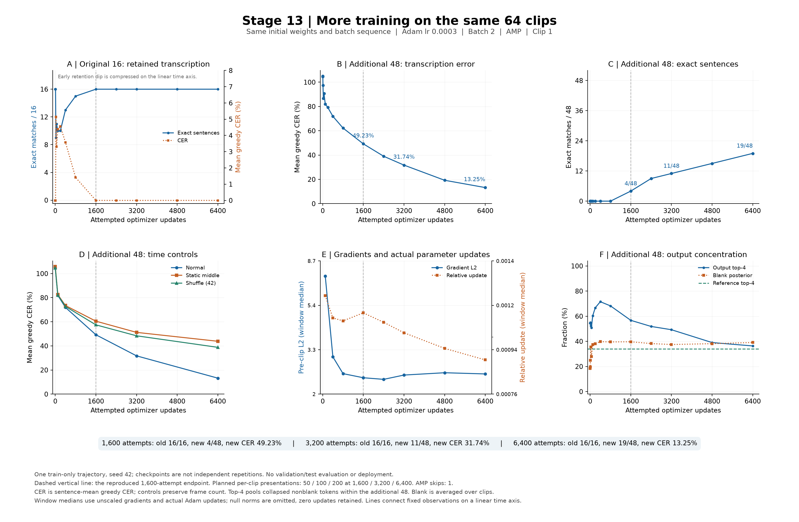

# 13단계 — 같은 64문장에서 학습량만 늘린 진단

같은64문장과 학습 설정을 유지하고 학습 시도를1,600→6,400회로 늘리자, 추가48문장의 자모 오류율이 **49.23%→31.74%→13.25%**, 완전 일치는 **4→11→19/48**로 개선됐다. 최종 기존16문장은 **16/16**, 자모 오류율 **0.00%**였다. 앞1,600회는12단계와 가중치·원시 출력·학습 기록까지 정확히 재현한 뒤 같은 학습 상태로 연장했다.

이 결과는 이64개에서 학습량을 더 주면 복원이 개선된다는 근거다. 1,000문장 학습 정체의 원인이 전부 학습량이었다거나 웹캠 인식이 가능해졌다는 뜻은 아니다. 이번 단계는 학습 표본 진단이며 추가 데이터 다운로드·val/test 추론·서비스 배포를 수행하지 않았다.

**목적과 비교 범위**

12단계에서는 같은 경량 모델로 기존16문장만 학습하면 복원이 유지됐고, 기존16+추가48을 학습하면 초기에 일부 문장을 잊었다가1,600회 시점에 기존16개를 다시 복원했다. 추가48개의 greedy 자모 오류율도104.72%→49.23%로 내려갔지만 완전 일치는4/48이었다. 학습량을 늘리면 이64개 안에서 복원이 더 개선되는지 확인하는 것이13단계의 목적이다.

13단계는 표본·초기 가중치·모델 구조·학습률·optimizer·batch·정밀도·seed·표본 순서를 유지하고 추가 학습 시도 예산만1,600→6,400회로 늘린다. 1,600/3,200/6,400회는 한 번의 같은 학습 과정에서 관측한 시점이며 독립 seed 반복실험이 아니다. 학습64개에 대한 복원과 대조 입력의 반응을 조사하며, val/test·새 화자·실제 웹캠 성능 평가와는 구분한다.

**실제 학습 결과**

아래 CER는 문장별 Unicode 분해 자모 편집거리/정답 자모 수의 평균이다. 낮을수록 좋으며, 음절 단위 정확도나 문장 정답률과 다르다. 완전 일치는 문장 전체 문자열이 정답과 같은 수다. 계획 노출은 이번 실험에서 문장당 제시한 횟수이고 초기 short16 선행 학습은 별도다.

| 학습 시도 / 계획 노출 | 기존16 greedy CER / 일치 | 추가48 greedy CER / 일치 | 추가48 beam10 CER / 일치 |
| --- | --- | --- | --- |
| 1,600회 / 50회 | 0.00% / 16/16 | 49.23% / 4/48 | 49.53% / 4/48 |
| 3,200회 / 100회 | 0.00% / 16/16 | 31.74% / 11/48 | 31.66% / 11/48 |
| 6,400회 / 200회 | 0.00% / 16/16 | 13.25% / 19/48 | 13.27% / 19/48 |

중간 2,400회에는 추가48 CER 39.02%·완전 일치 9/48, 4,800회에는 19.25%·15/48이었다. 고정 시점의 결과를 모두 보존했으며 최저 오차 시점을 골라 최종값으로 표시하지 않았다.

greedy와 beam의 최종 오류율 차이는 작다. 이번 개선은 beam 탐색을 강화해서 얻은 것이 아니라 같은 디코딩 기준으로 더 학습한 모델에서 관찰한 변화다.



**정지 영상과 프레임 순서 섞기 대조**

| 시도 / 집단 | 정상 greedy CER / 일치 | 중간 프레임 반복 | 순서 섞기42 |
| --- | --- | --- | --- |
| 1,600 / 기존16 | 0.00% / 16/16 | 15.04% / 9/16 | 12.48% / 10/16 |
| 1,600 / 추가48 | 49.23% / 4/48 | 60.51% / 1/48 | 57.46% / 0/48 |
| 3,200 / 기존16 | 0.00% / 16/16 | 18.51% / 8/16 | 14.22% / 9/16 |
| 3,200 / 추가48 | 31.74% / 11/48 | 51.22% / 5/48 | 48.38% / 5/48 |
| 6,400 / 기존16 | 0.00% / 16/16 | 20.54% / 8/16 | 14.68% / 10/16 |
| 6,400 / 추가48 | 13.25% / 19/48 | 43.83% / 8/48 | 38.81% / 10/48 |

최종 추가48에서 정상 입력의 CER는 정지보다 30.59%포인트, 섞기보다 25.56%포인트 낮다. 이 학습 표본에서는 정상 시간 흐름이 복원에 도움이 됐다. 대조 입력에도 문장 길이·정적 외형·화자 단서가 남고 입력 분포도 달라지므로, 새로운 발화의 입술 움직임을 정확히 읽는다는 증명으로 확대하지 않는다.

**남은 오류와 출력 분포**

| 추가48 프레임 길이 | 문장 수 | 1,600회 CER / 일치 | 3,200회 CER / 일치 | 6,400회 CER / 일치 |
| --- | --- | --- | --- | --- |
| 1–50 | 8 | 7.07% / 4/8 | 0.83% / 7/8 | 0.00% / 8/8 |
| 51–100 | 13 | 44.37% / 0/13 | 20.46% / 4/13 | 1.95% / 10/13 |
| 101–150 | 13 | 61.40% / 0/13 | 40.30% / 0/13 | 16.95% / 1/13 |
| 151–200 | 14 | 66.54% / 0/14 | 51.93% / 0/14 | 27.87% / 0/14 |

최종 추가48 중 100프레임 이하 21개는 18개를 완전히 복원했지만, 101프레임 이상 27개는 1개만 완전히 복원했다. 긴 문장 쪽에 남은 오류가 집중된 것이 다음 진단에서 확인할 핵심이다.

길이 구간은 집계 코드에서 정한 50프레임 간격이다. 실행 전 고정한 학습·평가 일정과는 별개의 기술 통계이며, 이 구간을 이용해 학습 표본이나 모델을 선택하지 않았다. 길이와 정답 자모 수·내용·화자·CTC 정렬 난도가 함께 달라지므로 길이 자체의 인과 효과를 분리한 결과는 아니다. 전체64개의 정답과0/1,600/3,200/6,400회 출력은 검증JSON의 sentence_trajectories에 전수 보존했다.

| 추가48 정상 입력 | 1,600회 | 3,200회 | 6,400회 |
| --- | --- | --- | --- |
| 자모당 CTC 손실 평균 | 1.66553 | 1.08033 | 0.43407 |
| 출력 전체의 상위4 토큰 비중 | 56.72% | 49.24% | 36.35% |
| 출력 토큰 종류 수 | 45 | 52 | 55 |
| blank posterior 평균 | 39.66% | 37.47% | 39.08% |
| argmax가 blank인 프레임 비율 평균 | 46.84% | 40.68% | 40.16% |

정답의 전체 상위4 토큰 비중은 34.04%, 토큰 종류는 56개다. 상위4는 각 분포 자체의 빈도 상위4개이므로 같은4개 토큰에 대한 비중 비교는 아니다. blank posterior는 확률 평균이고 argmax blank는 최댓값 경로의 비율이어서 서로 다른 지표다. 출력 편중·손실·복원 결과를 함께 해석하며, blank 비율 하나로 실패를 판정하지 않는다.

**기울기·실제 갱신·연산 상태**

| 시도 구간 | clip 전 전체 norm 중앙값 | 실제 상대 가중치 변화 중앙값 | 실질 clipping | skip |
| --- | --- | --- | --- | --- |
| 1–100 | 7.398654 | 0.001215 | 99 | 1 |
| 101–400 | 3.036459 | 0.001094 | 292 | 0 |
| 401–800 | 2.524288 | 0.001079 | 375 | 0 |
| 801–1,600 | 2.412618 | 0.001120 | 755 | 0 |
| 1,601–2,400 | 2.370479 | 0.001071 | 725 | 0 |
| 2,401–3,200 | 2.485159 | 0.001019 | 673 | 0 |
| 3,201–4,800 | 2.549528 | 0.000947 | 1289 | 0 |
| 4,801–6,400 | 2.516142 | 0.000896 | 1235 | 0 |

상대 변화는 ||갱신 후−전||₂/||갱신 전||₂이고, 기울기는 AMP unscale 후 측정했다. 비유한 norm은 중앙값에서 제외하고 개수를 따로 기록했다. 실제 변화0은 통계에 포함했다. 실질 clipping은 계수가1보다 작은 경우다. Adam의 실제 변화량은 clip 계수만으로 계산하지 않고 직접 측정했다.

총6,400회 중 **6,399회 성공 갱신·1회 skip**이었다. skip 시점은 49회(scale 1024→512)이다. 모든 문장은 계획상200회 제시됐고 성공 갱신 노출은 199–200회다. 건너뛴 시도는 가중치 변화0을 확인했다. scaler의 자동 증가/감소는 기존 동작을 유지했으며 결과를 본 뒤 학습률이나 scale을 바꾸지 않았다.

RTX3080에서 실행기 측정 시간은 평가를 포함해 1358.8초였다. PyTorch 최대 할당/예약 메모리는 715.6/1466.0MiB다. GPU 전체 사용량이나 대규모 데이터 학습의 메모리 요구량을 뜻하지 않는다.

**고정 조건**

| 항목 | 설정 |
| --- | --- |
| 초기 가중치 | 9단계 경량 short16의 마지막 추론 가중치 |
| 학습 자료 | v4 train의 기존16+사전 선정48, 총64개 |
| 모델 | 기존 경량3D-CNN→256차원 투영→2층BiLSTM→69토큰CTC |
| optimizer | 새Adam, lr0.0003, betas0.9/0.999, eps1e-8, weight decay0 |
| batch / 예산 | batch2, 누적 없음,6,400회 갱신 시도 |
| 표본당 계획 노출 | 이번 실험 안에서200회,200epoch |
| 정밀도 | 학습 AMP FP16 + CTC FP32, 평가 FP32 B1 |
| CTC | blank0, reduction mean, zero_infinity=False |
| clipping | unscale 후 전체 gradient norm1 |
| GradScaler | 초기1,024, 기존 기본 growth/backoff 유지 |
| seed / 표본 순서 | seed42, 매epoch 전체index를 local RNG로 섞고2개씩 배치 |
| 백엔드 | CPU thread2, cuDNN deterministic=True/benchmark=False, TF32=False |
| 모델 선택 | 고정6,400회 완료, 성능 기반 조기 중단·best 선택 없음 |

GradScaler는 학습 중 scale을 스스로 높이거나 낮출 수 있다. 더 긴 학습에서 추가 skip이 생겨도 scale이나 학습률을 임의로 고정하지 않는다. 시도 횟수와 실제 성공 갱신, 문장별 성공 노출을 별도로 기록한다.

**12단계 재현 검사**

12단계 B의 마지막 가중치에 새Adam을 붙이면 optimizer 상태가 달라진다. 따라서 공통 short16 가중치에서 새로 시작해 앞1,600회의 학습 과정을 재현한 뒤, 같은 optimizer/scaler/RNG 상태로1,601회부터 계속한다.

실행 전에12단계 원본 명세·가중치·소스·결과 파일의 SHA-256을 확인하고,6,400회 배치 일정의 앞1,600개가 이전 B 일정과 완전히 같은지 검사한다. 이전 환경의 PyTorch·CUDA·NumPy·Python·GPU도 대조한다.

이전의 관측 시점0/1/5/10/25/50/100/200/400/800/1,600에서 모든 모델 tensor, 원시 log posterior 배열, 문장별 예측·지표를 정확 비교한다. 앞1,600개 telemetry도 벽시계 시간인 seconds만 제외하고 모두 정확 비교한다. CER를 반올림해 같다고 판정하거나 파일의 SHA 자체를 같아야 한다고 요구하지 않는다. 새 체크포인트에는 다른 계획·목적 메타데이터가 포함되므로 파일 해시는 달라질 수 있다.

재현 검사가 실패하면1,601회 학습 전에 중단하도록 고정했다. 불일치를 숨기거나 결과를 본 뒤 허용 오차를 완화하는 계획은 없다.

**평가와 저장 시점**

- 정상 greedy·CTC:0,1,5,10,25,50,100,200,400,800,1,600,2,400,3,200,4,800,6,400회.
- 정지/순서 섞기42 대조:0,100,400,1,600,3,200,6,400회.
- 실제beam10:0,1,600,3,200,6,400회. 다른 시점의greedy를beam으로 표시하지 않는다.
- 추론 가중치: 각 고정 평가 시점. 초기0회는 공통 short16 원본을 참조한다.
- 재개용 전체 상태:1,600/3,200/6,400회. 평가가 학습 모드와 RNG를 복원한 뒤 저장한다.
- 모든 시도: unscale 후clip 전·후CNN/투영/BiLSTM/출력층 기울기, 실제 가중치 변화,scaler/skip/노출을 기록한다.

정지 입력은 중간 프레임을 원래T만큼 반복한다. 섞기는 ID와seed42로 정한 같은 순열이다. 두 조건은 모두T와 정적 외형 단서를 보존하므로, 정상 입력과의 차이만으로 새로운 발화를 정확히 읽는 능력을 증명하지 않는다.

**재개 상태 보존**

추론용 `step_XXXX.pt`와 별도로 `training_state_XXXX.pt`에 모델·Adam의1/2차 moment 및step·GradScaler·Python/NumPy/torch CPU/모든CUDA 난수 상태·각module의train/eval 모드·백엔드 설정·표본 일정 hash·출처·누적 갱신/노출을 저장한다. `weights_only=True`로 읽을 수 있는 형식이다. 다음 시도 시작 시 zero_grad를 수행하므로 직전 gradient 자체는 재개 파일에 저장하지 않는다.

상태 저장·복원이 학습을 바꾸지 않는지는 합성 자료의 CPU와 실제compact CUDA 모델에서 검사했다. 이번 실제 실험은 중간에 재시작하지 않고 연속 실행하며, 파일을 저장하는 것과 실제 작업 중단 후 재개를 수행한 것은 구분한다. 재개 함수는 제공하지만 실행기의 자동 재개 CLI를 추가한 것은 아니다.

**산출물과 해석 범위**

모든 실험 결과는 새로운 `results/step13-budget/run01`에 보존하며 이전12단계 파일을 덮어쓰지 않는다. 모델은 `smoke_only / train_subset_budget_diagnostic` 목적으로 표시한다. 진단용 가중치를 웹캠 서비스에 배포하지 않는다.

이 단계에서 추가 데이터 다운로드는 필요하지 않았다. 향후 자료가 필요해지면 종류·규모·이유를 먼저 안내한다. 학습64개를 잘 복원하더라도 학습bbox와웹캠ROI 차이, 새 화자·촬영 조건·발화에 대한 일반화는 별도 검증 과제로 남는다.

재실행은 새 출력 폴더를 지정한다.

```powershell
$env:OMP_NUM_THREADS='2'
$env:MKL_NUM_THREADS='2'
& '.\.venv-gpu\Scripts\python.exe' scripts/diagnose_learning_budget.py --out results/step13-budget/new-run
& '.\.venv-gpu\Scripts\python.exe' scripts/summarize_learning_budget.py --run results/step13-budget/new-run --out results/step13-budget/new-run/summary.json
```

명세 SHA-256: `214ce935150b367a15f24f0896901d34c54c6d4fe73d493a9d397c4c94fe59a6`.

초기 가중치 SHA-256: `a426118a54b4214d7a53fc31ea02cf538cc69ccab7e025600cd62d2cf2226613`.

**검증 범위와 산출물**

새 관련 검사는 서로 다른49개가 통과했다: 재개 상태11개, 실행기10개, 집계28개. 별도 실행 합계이며 전체 프로젝트 테스트 재실행은 아니다. 합성 자료의 CPU 검사와 실제compact CUDA 모델 검사에서 중단 없이 학습한 결과와 저장·복원 후 학습한 결과의 가중치·Adam·scaler·RNG 일치를 확인했다.

집계기는 저장 posterior 1,728행의 greedy·CER/WER·CTC 손실·분포·대조 지표를 다시 계산했다. beam 768행은 저장 문자열을 재채점했으며 beam 탐색을 다시 실행하지는 않았다. 원시 gradient는 저장하지 않아 해당 기록은 hash·내부 정합·계측 검증으로 확인했다. 캐시hash와 대조 변환index는 검증했지만 pixel_changed_frame_count는 범위 검사이고 픽셀 재계산이 아니다.

전체 재개 파일3개는 CPU에서 가중치·Adam 상태·scaler·RNG 형식·출처·일정·누적 횟수를 검증했다. 실제자료의 중단 후 재개 실행을 추가로 수행한 것은 아니다. 고정 학습 소스15개와 입력·12단계 원본의 hash도 유지됐다.

- [검증 JSON](13_검증결과.json) · [비교 그래프](13_학습예산_비교.png)
- [고정 계획](../../results/step13-budget/run01/plan.json) · [완료 기록](../../results/step13-budget/run01/completed.json)
- [앞1,600회 정확 재현 검사](../../results/step13-budget/run01/prefix_gate.json)
- [1,600회 재개 상태 독립 읽기 감사](../../results/step13-budget/run01/resume_state_audit_1600.json)
- [최종 파일·검사 기록](../../results/step13-budget/run01/quality_checks.json)
- [학습 실행기](../../scripts/diagnose_learning_budget.py) · [전체 상태 저장/복원](../../scripts/learning_budget_state.py)
- [집계·검증](../../scripts/summarize_learning_budget.py) · [그래프 생성](../../scripts/plot_learning_budget.py)

**다음14단계 제안 — 같은 출발 상태에서 학습률만 비교**

6,400회에도 여러 학습 문장에 오류가 남아 있다. 학습률이 높아서 정체됐다고 확정한 것은 아니며, 현재 학습량 범위에서는 개선이 이어졌다. 다음에는6,400회의 전체 상태에서 A는lr0.0003 유지, B는lr0.0001로 감소시켜 각각3,200회 추가 시도하는 통제 비교를 권한다. 두 군 모두 같은 모델·Adam moment·scaler·RNG·64개 표본·배치 순서·clip을 복원하고 학습률만 바꾼다. 단순히 더 오래 학습한 효과와 학습률 변경 효과를 분리하기 위한 비교다.

추가 구간6,401–9,600회는 문장당 계획100회 노출이며 종료 시점과 정상/정지/섞기 평가를 실행 전에 고정한다. 기존16 유지, 추가48 복원, 길이별 오류와 출력 편중을 함께 본다. A/B 결과에 따라 현재64개의 학습 설정을 정리한 뒤 학습 규모 확대와 화자 분리 검증으로 넘어간다. 학습 표본 암기만으로 일반화와 실제 웹캠 목표가 달성되지는 않는다.

구현할 때는 두 군 모두 원래6,400회 계약으로 상태를 복원한 뒤 B의 optimizer 학습률만 바꾼다. 9,600회 전체 배치 일정을 만들고 앞6,400개가 기존 일정과 일치하는지 확인한 뒤6,401회부터 진행한다. 새 Adam으로 초기화하거나 배치 순서를 다시 시작하지 않는다.

14단계는 이번에 실행하지 않았다. 제안한 비교는 기존 자료로 할 수 있으며, 추가 데이터가 필요한 단계가 오면 종류·규모·이유를 먼저 안내한다.
