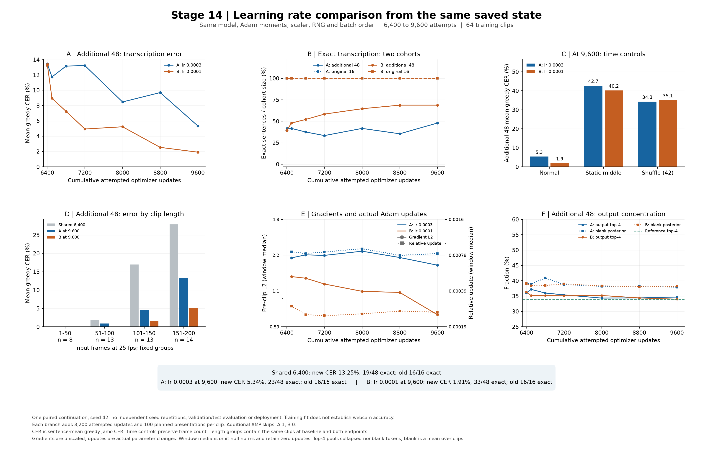

# 14단계 — 같은 학습 상태에서 학습률 유지와 감소 비교

14단계를 완료했다. 같은 6,400회 전체 학습 상태에서 각각 3,200회 더 학습한 결과, 추가 48문장의 최종 자모 오류율은 **A 유지군 5.34%, B 감소군 1.91%**, 완전 일치는 **A 23/48, B 33/48**이었다. 공통 시작값은 13.25%·19/48이었다. 기존 16문장은 두 군 모두 16/16을 복원했다.

최종 B의 추가48 오류율은 A보다 3.43%포인트 낮았다. 이는 같은 학습64개·한 출발 상태·정해진 추가 예산에서의 비교다. 새 화자나 실제 웹캠 성능은 이번에 평가하지 않았으며, 최적 학습률을 일반적으로 확정하는 결과로 해석하지 않는다.

**고정 종료 시점의 결과**

오류율은 문장별 Unicode 분해 자모 편집거리/정답 자모 수의 평균이다. 낮을수록 좋다. 완전 일치는 문장 전체 문자열을 맞춘 개수이며 자모 오류율의 보수와 같지 않다.

| 모델 / 누적 시도 | 기존16 greedy CER / 일치 | 추가48 greedy CER / 일치 | 추가48 beam10 CER / 일치 |
| --- | --- | --- | --- |
| 공통 시작 / 6,400 | 0.00% / 16/16 | 13.25% / 19/48 | 13.27% / 19/48 |
| A 유지 / 9,600 | 0.00% / 16/16 | 5.34% / 23/48 | 5.33% / 24/48 |
| B 감소 / 9,600 | 0.00% / 16/16 | 1.91% / 33/48 | 1.86% / 33/48 |

중간 평가의 최저 오류율을 선택하지 않고, 사전에 고정한9,600회 결과를 비교했다. 시작값이 두 군에서 동일한 것은 단순히 반올림 수치가 같은 것이 아니라 모든 시작 가중치·원시 posterior·예측 행을 정확 비교해 확인한 결과다.



**학습 중 변화**

| 누적 / 추가 시도 | A 추가48 CER / 일치 | B 추가48 CER / 일치 | A 기존16 일치 | B 기존16 일치 |
| --- | --- | --- | --- | --- |
| 6,400 / 0 | 13.25% / 19/48 | 13.25% / 19/48 | 16/16 | 16/16 |
| 6,401 / 1 | 13.45% / 20/48 | 13.39% / 19/48 | 16/16 | 16/16 |
| 6,500 / 100 | 11.74% / 20/48 | 8.95% / 23/48 | 16/16 | 16/16 |
| 6,800 / 400 | 13.16% / 18/48 | 7.24% / 25/48 | 16/16 | 16/16 |
| 7,200 / 800 | 13.22% / 16/48 | 4.94% / 28/48 | 16/16 | 16/16 |
| 8,000 / 1,600 | 8.47% / 20/48 | 5.23% / 31/48 | 16/16 | 16/16 |
| 8,800 / 2,400 | 9.70% / 17/48 | 2.54% / 33/48 | 16/16 | 16/16 |
| 9,600 / 3,200 | 5.34% / 23/48 | 1.91% / 33/48 | 16/16 | 16/16 |

두 군은 같은 순서로 같은 영상을 제시받지만, 학습률이 달라진 뒤에는 가중치·기울기·Adam moment가 서로 달라질 수 있다. 첫 6,401회의 입력·loss·clip 전후 기울기 계측값·scaler 기록은 정확히 같았고, 저장 가중치로 직접 계산한 변화량의 B/A 비율은 0.3333333221이었다. 원시 기울기 tensor나 첫 갱신 직후 Adam·RNG 상태를 별도로 저장하지 않아, 실제 첫 갱신 후 이 상태까지 직접 대조한 것은 아니다.

**입력 대조와 길이별 잔여 오류**

| 시점 / 집단 | 정상 greedy CER / 일치 | 중간 프레임 반복 | 순서 섞기42 |
| --- | --- | --- | --- |
| 공통6,400 / 기존16 | 0.00% / 16/16 | 20.54% / 8/16 | 14.68% / 10/16 |
| 공통6,400 / 추가48 | 13.25% / 19/48 | 43.83% / 8/48 | 38.81% / 10/48 |
| A9,600 / 기존16 | 0.00% / 16/16 | 17.77% / 9/16 | 13.31% / 10/16 |
| A9,600 / 추가48 | 5.34% / 23/48 | 42.66% / 9/48 | 34.29% / 13/48 |
| B9,600 / 기존16 | 0.00% / 16/16 | 17.23% / 9/16 | 12.72% / 10/16 |
| B9,600 / 추가48 | 1.91% / 33/48 | 40.15% / 11/48 | 35.11% / 12/48 |

정상 입력과 대조 입력의 차이는 이 학습 표본에서 시간 흐름의 변화에 얼마나 민감한지 보여준다. 정지·섞기에도 길이·외형·화자 단서가 남고 변형 자체의 분포 차이가 있으므로, 새로운 발화를 입술 움직임으로 정확히 읽는다는 증명으로 확대하지 않는다.

| 추가48 프레임 길이 | 문장 수 | 공통6,400 CER / 일치 | A9,600 CER / 일치 | B9,600 CER / 일치 |
| --- | --- | --- | --- | --- |
| 1–50 | 8 | 0.00% / 8/8 | 0.00% / 8/8 | 0.00% / 8/8 |
| 51–100 | 13 | 1.95% / 10/13 | 0.86% / 11/13 | 0.00% / 13/13 |
| 101–150 | 13 | 16.95% / 1/13 | 4.63% / 2/13 | 1.63% / 8/13 |
| 151–200 | 14 | 27.87% / 0/14 | 13.21% / 2/14 | 5.04% / 4/14 |

감소군은 100프레임 이하 21문장을 모두 복원했고, 그보다 긴 27문장은 12개를 완전히 복원했다. 자모 오류율은 낮아졌지만 추가 48개 중 15개에는 여전히 문자열 오류가 남아 있다.

50프레임 간격의 기술 통계이며 이 구간으로 학습 표본이나 모델을 선택하지 않았다. 길이와 문장 내용·화자·자모 수·CTC 정렬 난도가 함께 달라져 길이 자체의 원인을 분리한 실험은 아니다. 전체64개 모든 관측 시점의 출력은 검증JSON의 각 branch.sentence_trajectories에 보존했다.

**출력 분포·실제 갱신·안정성**

| 추가48 정상 입력 | 공통6,400 | A9,600 | B9,600 |
| --- | --- | --- | --- |
| 자모당 CTC 손실 평균 | 0.43407 | 0.18486 | 0.10437 |
| 출력 전체의 상위4 토큰 비중 | 36.35% | 34.69% | 33.98% |
| 출력 토큰 종류 | 55 | 55 | 56 |
| blank posterior 평균 | 39.08% | 37.90% | 38.21% |
| argmax blank 비율 평균 | 40.16% | 38.45% | 38.50% |

정답의 상위4 토큰 비중은34.04%, 종류는56개다. 상위4는 각 분포 자체에서 고른4개로 동일 토큰 집합의 비교가 아니다. blank의 확률 평균과 최댓값 경로의 blank 비율도 서로 다른 지표다. 분포 지표를 복원·손실과 함께 읽으며 하나의 비율만으로 학습 성공이나 실패를 판정하지 않는다.

| 군 / 누적 시도 구간 | loss 평균 | clip 전 norm 중앙값 | 실제 상대 변화 중앙값 | 실질 clipping / skip |
| --- | --- | --- | --- | --- |
| A 유지0.0003 / 6,401–6,500 | 0.34037 | 2.112211 | 0.000845 | 70 / 0 |
| A 유지0.0003 / 6,501–6,800 | 0.30421 | 2.233087 | 0.000816 | 214 / 0 |
| A 유지0.0003 / 6,801–7,200 | 0.27871 | 2.211517 | 0.000842 | 284 / 0 |
| A 유지0.0003 / 7,201–8,000 | 0.27147 | 2.389426 | 0.000899 | 582 / 1 |
| A 유지0.0003 / 8,001–8,800 | 0.21442 | 2.126022 | 0.000787 | 532 / 0 |
| A 유지0.0003 / 8,801–9,600 | 0.19051 | 1.845427 | 0.000815 | 518 / 0 |
| B 감소0.0001 / 6,401–6,500 | 0.28121 | 1.495191 | 0.000284 | 65 / 0 |
| B 감소0.0001 / 6,501–6,800 | 0.23132 | 1.449822 | 0.000240 | 185 / 0 |
| B 감소0.0001 / 6,801–7,200 | 0.19004 | 1.302704 | 0.000235 | 227 / 0 |
| B 감소0.0001 / 7,201–8,000 | 0.15947 | 1.137918 | 0.000244 | 416 / 0 |
| B 감소0.0001 / 8,001–8,800 | 0.12871 | 1.115270 | 0.000258 | 421 / 0 |
| B 감소0.0001 / 8,801–9,600 | 0.10132 | 0.739204 | 0.000251 | 367 / 0 |

기울기는 AMP unscale 후 값이다. 상대 변화는 ||갱신 후−전||₂/||갱신 전||₂를 직접 계산했다. 비유한 norm은 중앙값에서 제외하고 따로 기록했고 실제 변화0은 포함했다. 실질 clipping은 계수가1보다 작은 경우다.

A 유지0.0003: 이번3,200회에서 성공 3,199회·skip 1회, 누적 성공 9,598회·skip 2회다. 추가 skip은 7,560회(4096→2048)이고 문장별 이번 성공 노출은 99–100회다. 평가 포함 분기 시간은 690.1초, PyTorch 최대 할당/예약 메모리는 715.5/1486.0MiB다.

B 감소0.0001: 이번 3,200회 모두 갱신에 성공했고, 누적 성공 9,599회·skip 1회다. 이번 추가 구간의 skip은 없고 모든 문장이 100회씩 성공 갱신에 반영됐다. 평가 포함 분기 시간은 686.0초, PyTorch 최대 할당/예약 메모리는 714.9/1292.0MiB다.

GPU는RTX3080이며 시간은 초기 두 군 재현 평가와 분기 학습을 구분해 기록했다. 위 메모리는 PyTorch 계측값이고 GPU 전체 사용량을 뜻하지 않는다. skip은 실제 가중치 변화0이었음을 검사했으며, 두 군의 같은 시도 예산과 같은 성공 갱신 횟수를 혼동하지 않는다.

**목적**

13단계에서 같은64개를1,600→6,400회 학습하자 추가48문장의 자모 CER가49.23%→13.25%, 완전 일치가4/48→19/48로 개선됐다. 기존16문장은 최종 모두 복원했다. 하지만101프레임 이상27문장의 완전 일치는1개로, 긴 문장군에 학습 오류가 많이 남았다. 길이와 문장·화자·정렬 난도를 분리한 결과는 아니다.

14단계는 학습률을 낮추면 같은 추가 예산에서 복원이 더 좋아지는지 조사한다. 현재 학습률이 오류의 원인이라고 단정하지 않으며, 유지군도 계속 학습해 단순히 더 오래 학습한 효과와 학습률 변경 효과를 비교한다.

**실행 전에 고정한 조건**

| 항목 | 설정 |
| --- | --- |
| 공통 출발점 | 13단계6,400회 전체 학습 상태 |
| A 유지군 | Adam 학습률0.0003 |
| B 감소군 | Adam 학습률0.0001 |
| 자료 | 기존v4 train의 같은64개: 기존16+추가48 |
| 추가 예산 | 각6,401–9,600회,3,200회 시도, 문장당 계획100회 추가 제시 |
| 유지 조건 | 모델·Adam moment/step·GradScaler·모든 RNG·batch2·AMP·clip1·표본 순서·전처리·토큰 사전 |
| 순서 | seed42로9,600회 전체 일정을 생성, 앞6,400개가 이전 일정과 정확히 같은지 검사 후 이어서 사용 |
| 정상 평가 | 누적6,400/6,401/6,500/6,800/7,200/8,000/8,800/9,600회 |
| 정지·섞기42 대조 | 6,400/7,200/8,000/9,600회 |
| 실제beam10 | 6,400/8,000/9,600회 |
| 전체 상태 저장 | 각 군6,400/8,000/9,600회 |
| 선택 기준 | 고정9,600회 비교, 성능 기반 조기 종료·최저점 선택 없음 |

구조는 기존 경량3D-CNN→256차원 투영→2층BiLSTM→69토큰CTC다. 정상 평가는 FP32·문장별 실제 길이·batch1이다. 정지 대조는 중간 프레임 반복, 섞기는 같은ID·seed42 순열이며 프레임 수를 유지한다.

**실제 재개와 시작 상태 검사**

이 단계에서는13단계의 실제자료 전체 상태를 불러와 학습을 재개한다. optimizer를 생성한 뒤 저장 Adam 상태를 로드하므로 Adam moment나step이0으로 초기화된 상태에서 진행하지 않는다. 저장된 학습률까지 복원한 다음 B의 학습률만 바꾼다.

학습 전에 두 군 각각 모델·Adam·scaler·RNG·모드·백엔드의 정확 복원을 검사한다. 학습률 변경 후에는 학습률 외 모든 실행 상태가 정확히 같은지 확인한다. 두 군의6,400회 정상·정지·섞기 원시 posterior와 예측 행도13단계와 정확히 비교한다. 평가가 RNG와학습 상태를 보존하는지 검사하고 두 군의 시작 상태를 각각 저장한다. 두 군 모두 이 검사를 통과한 뒤에만 학습을 시작한다.

각 군을 실행하기 직전에 준비된 전체 상태를 다시 불러와 재검사한다. A를 실행한 뒤 전역 난수 상태가 바뀌어도 B는 저장된 동일 출발 상태로 돌아간다. 이전15개 학습 관련 소스와13단계 결과를 덮어쓰지 않고,14단계 실행기를 포함한16개 소스를 hash로 고정한다.

**계수와 해석 범위**

누적시도는6,400→9,600회이고 이번 추가시도는 각3,200회다. 시작시 성공갱신6,399회·AMP skip1회를 이어 기록하며, 이번 단계의 성공갱신·skip·표본 노출은 누적값과 분리한다. 표본당 이번 추가100회와13단계까지의200회를 합하면 계획상300회지만 초기 short16 선행학습은 별도다.

학습률 차이로 이후 overflow·scaler·skip이 달라질 수 있으므로 계획된 같은 배치 수와 실제 성공갱신 노출을 구분한다. 결과는 한 출발 상태·한 배치 일정의 비교이며 독립seed 반복실험이 아니다. 두 군 모두 학습64개에서 평가하므로 일반화나 실제 웹캠 인식 성능을 뜻하지 않는다. val/test 캐시 추론·새 화자 평가·서비스 배포는 이번 범위에 포함하지 않는다.

추가 데이터 다운로드는 필요하지 않다. 이후 자료가 필요한 단계가 오면 종류·규모·이유를 먼저 안내한다.

**실행 파일과 재현**

원시 결과는 `results/step14-learning-rate/run01`의A_keep/B_reduce에 보존한다. 진단용 추론 가중치는 `smoke_only / train_subset_lr_diagnostic`로 표시하고, 재개 파일과 구분한다. 재실행 시에는 새 출력 폴더를 지정한다.

```powershell
$env:OMP_NUM_THREADS='2'
$env:MKL_NUM_THREADS='2'
& '.\.venv-gpu\Scripts\python.exe' scripts/diagnose_learning_rate.py --out results/step14-learning-rate/new-run
& '.\.venv-gpu\Scripts\python.exe' scripts/summarize_learning_rate.py --run results/step14-learning-rate/new-run --out results/step14-learning-rate/new-run/summary.json
```

**검증과 산출물**

관련 신규 검사 66개가 통과했다(실행기 26개 및 집계 40개). 전체 프로젝트 테스트 재실행이 아니다. 합성 CPU·실제 경량 CUDA 검사에서 유지군 재개 결과가 중단 없는 학습과 정확히 같고, 감소군 첫 갱신은 같은 기울기 계측값·Adam moment·RNG를 유지하면서 실제 변화가 약 1/3임을 확인했다.

실제자료의 두 군 초기 상태를 원본과 비교했고 A의 실제첫갱신 가중치차이를 별도CPU계산해 telemetry와 대조했다. 집계기는 원시posterior 2,048행을 다시 계산하고 beam 1,152행의 저장문자열을 재채점했다. beam탐색을 다시 실행한 것은 아니다. 초기192행씩의 원시출력은13단계와 최대차0으로 정확히 일치했다.

실제 학습은 저장 상태를 복원해 재개했으며, 이후 8,000/9,600회의 저장 상태는 CPU에서 구조·유한성·counter·가중치·hash를 검사했다. 최종 9,600회 A/B의 저장 RNG·모드·백엔드도 정확히 일치했다. 각 Adam step과 scaler는 실제 갱신·skip 기록으로 재구성한 값과 일치했다. 그 후반 파일을 다시 학습하여 전체 경로를 재실행한 것은 아니다. raw gradient는 저장하지 않아 telemetry는 hash·내부 정합·계측 검사로 검증했다. 캐시 hash·변환 index는 검증했고 pixel_changed_frame_count는 범위 검사이며 픽셀 재계산은 아니다. 원래 13단계 소스·결과와 이번 고정 16개 소스의 hash를 유지했다.

- [검증 JSON](14_검증결과.json) · [비교 그래프](14_학습률_비교.png)
- [고정 계획](../../results/step14-learning-rate/run01/plan.json) · [완료 기록](../../results/step14-learning-rate/run01/completed.json)
- [두 군 시작 검사](../../results/step14-learning-rate/run01/preflight_gate.json) · [초기 상태 독립 감사](../../results/step14-learning-rate/run01/initial_state_audit.json)
- [첫 실제 갱신 독립 대조](../../results/step14-learning-rate/run01/paired_first_update_audit.json)
- [최종 상태 독립 감사](../../results/step14-learning-rate/run01/final_state_audit.json)
- [최종 파일·검사 기록](../../results/step14-learning-rate/run01/quality_checks.json)
- [실행기](../../scripts/diagnose_learning_rate.py) · [집계·검증](../../scripts/summarize_learning_rate.py) · [그래프 생성](../../scripts/plot_learning_rate.py)

**다음15단계 제안 — 고정 모델의 미학습 영상 전이 진단**

같은 64개를 복원하는 것과 새 발화·화자를 읽는 능력을 분리하기 위해, 다음에는 추가 학습 없이 13단계 6,400회·A 9,600회·B 9,600회의 세 고정 모델을 비교하는 것을 권한다. 학습 64개와 ID·녹화가 겹치지 않는 기존 train 후보 497개(8화자)에서 화자와 길이를 고려해 60개를 실행 전에 고정한다. 새로운 2화자의 기존 val20과 함께 정상·정지·고정 섞기 입력을 비교하며 기존 자료로 진행할 수 있다.

후보 497개의 길이 분포는 1–50프레임 5개, 51–100프레임 213개, 101–150프레임 207개, 151–200프레임 72개여서 모든 구간에 같은 수를 배정할 수는 없다. 가용량을 고려한 층별 선정이 필요하다. 이후 평가에서 화자별·길이별 결과를 나누며, train60과 val20의 차이를 화자 변화만의 인과 효과로 단정하지 않는다. val20은 개발 평가이며 최종 test50과 실제 웹캠 정확도는 별도로 남긴다.

이번에는 명세에서 후보 가능성만 확인했다. 15단계의 60개 ID 선정·캐시 열람·추론은 실행하지 않았다. 결과를 본 뒤 유리한 표본이나 체크포인트를 고르지 않도록 평가 표본·지표·범위를 먼저 확정한다. 추가 학습 자료가 필요해지는 단계에서는 종류·규모·이유를 먼저 안내한다.
