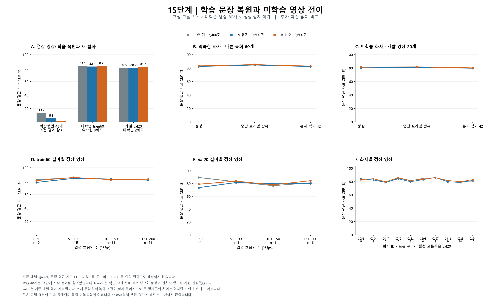

# 15단계 — 미학습 영상의 일반화와 시간 정보 활용 진단

15단계를 완료했다. **학습 영상 복원 성과가 새 발화 인식으로 이어지지는 않았다.** 세 고정 모델 모두 익숙한 화자의 새 영상60개와 다른 화자의 개발 검증20개에서 문장 완전 일치가0이었다. 학습 표본에 대한 적합은 개선됐지만, 현재 모델로 웹캠의 새로운 말을 텍스트로 읽을 성능은 확보하지 못했다.

14단계 B 모델의 학습 추가48문장 CER는1.91%였지만, 이번 익숙한 화자의 새 영상에서는 **83.24%**, 다른 화자에서는 **81.35%**였다. 학습48과 평가60/20은 서로 다른 문장·길이 분포이므로 이 차이를 통제된 단일 효과 크기로 해석하지 않는다.

**정상 영상의 결과**

주 지표는 greedy 디코딩의 문장 평균 자모 오류율(CER)이다. Unicode NFD로 분해한 정답 자모 수에 대한 편집거리 비율을 문장별로 계산한 뒤 평균했다. 낮을수록 좋으며 삽입 오류 때문에100%를 넘을 수 있다. 1−CER를 프로그램 인식 정확도로 환산하지 않는다.

| 고정 모델 | 새 영상60 CER / 완전 일치 | 개발 검증20 CER / 완전 일치 | 새 영상60 beam10 CER | 개발 검증20 beam10 CER |
| --- | ---: | ---: | ---: | ---: |
| 13단계 / 6,400회 | 83.06% / 0/60 | 80.47% / 0/20 | 83.00% | 80.23% |
| 14단계 A 유지 / 9,600회 | 82.38% / 0/60 | 80.18% / 0/20 | 82.33% | 80.11% |
| 14단계 B 감소 / 9,600회 | 83.24% / 0/60 | 81.35% / 0/20 | 83.24% | 81.05% |

beam10에서도 세 모델의 완전 일치는 두 집단 모두0이었다. 디코딩 방식을 바꾸는 것만으로 현재의 일반화 부족을 해결하지 못했다. 세 종료 가중치를 모두 보고했으며 이 평가에서 점수가 가장 낮은 가중치를 새 best로 선정하거나 배포하지 않았다.



**평가 자료를 고른 기준**

- 기준 자료는 기존 `aihub_timed_v4`다. 이 세 가중치의 학습 이력은 짧은16문장 선행 학습 후 동일한64문장 학습으로 이어진다. 별도 전체1,000문장 모델과는 다른 가중치 계보다.
- train1,000개에서 학습64개를 제외하고, 그64개와 같은 녹화에서 잘라낸439개도 제외했다. 남은497개 중 정규화한 정답이 학습64개와 완전히 같은 후보는0개였다.
- 예측을 보기 전에 seed42와 SHA256 순서로 길이별 할당량을 정하고, 각 길이 안에서 화자를 번갈아 선택했다. 길이1–50/51–100/101–150/151–200프레임의 train60 표본 수는5/19/18/18이다. 가장 짧은 후보가5개뿐이므로 나머지 할당량을 다른 구간으로 넘겼다.
- train60은 익숙한 화자8명·학습과 다른 녹화37개다. 화자별6–9개가 들어갔다. 기존 val20은 전부 사용했으며 다른 화자2명·녹화4개이고, 길이별 표본 수는1/8/8/3이다.
- 학습64와 평가80 사이의 영상ID·녹화ID·정규화 문장 중복은 없다. 두 집단은 길이·내용·녹화 조건도 다르므로 점수 차이를 순수한 화자 차이로 해석하지 않는다.
- train60은 길이와 화자를 고려한 진단 표본이며 전체 모집단의 무작위 표본이 아니다. val20은 이전 개발 단계에서도 살펴본 검증 자료다. 독립된 최종 시험 결과가 아니며 같은 녹화의 여러 문장을 독립 표본으로 간주하지 않는다.

**정지 영상과 순서 섞기 대조**

| 모델 / 집단 | 정상 CER | 중간 프레임 반복 CER | 순서 섞기42 CER |
| --- | ---: | ---: | ---: |
| 13단계 / 6,400회 / 익숙한 화자의 새 영상60 | 83.06% | 84.67% | 82.83% |
| 13단계 / 6,400회 / 다른 화자의 개발 검증20 | 80.47% | 81.47% | 79.68% |
| 14단계 A 유지 / 9,600회 / 익숙한 화자의 새 영상60 | 82.38% | 84.52% | 82.26% |
| 14단계 A 유지 / 9,600회 / 다른 화자의 개발 검증20 | 80.18% | 81.08% | 80.12% |
| 14단계 B 감소 / 9,600회 / 익숙한 화자의 새 영상60 | 83.24% | 85.17% | 82.93% |
| 14단계 B 감소 / 9,600회 / 다른 화자의 개발 검증20 | 81.35% | 81.77% | 80.26% |

정지 조건은 중간 프레임을 원래 길이만큼 반복한다. 섞기 조건은 각 영상ID와 seed42로 고정한 순열을 세 모델에 공통 적용한다. 모든 조건에서 프레임 수T를 유지했다. 정상 영상이 섞기보다 일관되게 좋지 않았으며, 학습 영상에서 관찰했던 큰 정상 입력 이점이 새 문장의 정확한 복원으로 이어졌다는 증거는 없었다. 입력을 바꾸면 출력 확률이 변한다는 사실만으로 유효한 입술 움직임 인식을 입증할 수는 없다.

**길이별 정상 영상 결과**

| 집단 / 프레임 수 | 문장 수 | 13단계 CER | A CER | B CER |
| --- | ---: | ---: | ---: | ---: |
| 익숙한 화자의 새 영상60 / 001-050 | 5 | 82.03% | 78.05% | 80.81% |
| 익숙한 화자의 새 영상60 / 051-100 | 19 | 85.07% | 84.02% | 85.35% |
| 익숙한 화자의 새 영상60 / 101-150 | 18 | 82.90% | 82.80% | 82.14% |
| 익숙한 화자의 새 영상60 / 151-200 | 18 | 81.38% | 81.43% | 82.77% |
| 다른 화자의 개발 검증20 / 001-050 | 1 | 89.47% | 73.68% | 78.95% |
| 다른 화자의 개발 검증20 / 051-100 | 8 | 82.80% | 81.58% | 83.82% |
| 다른 화자의 개발 검증20 / 101-150 | 8 | 76.74% | 79.70% | 78.01% |
| 다른 화자의 개발 검증20 / 151-200 | 3 | 81.20% | 79.88% | 84.48% |

각 길이 구간에서도 문장 완전 일치는0이었다. 특히 개발 검증의 가장 짧은 구간은1문장뿐이어서 길이별 차이를 일반적인 경향으로 확정할 수 없다. 화자별 상세 수치와 표본ID는 [검증 JSON](15_검증결과.json)에 저장했다.

**출력 분포와 학습 이후의 변화**

| 모델 / 집단 | 정답 토큰당 CTC loss | 평균 blank 확률 | greedy 출력 토큰 종류 |
| --- | ---: | ---: | ---: |
| 13단계 / 6,400회 / 익숙한 화자의 새 영상60 | 4.9594 | 42.46% | 47 |
| 13단계 / 6,400회 / 다른 화자의 개발 검증20 | 5.2629 | 44.10% | 38 |
| 14단계 A 유지 / 9,600회 / 익숙한 화자의 새 영상60 | 5.8320 | 42.78% | 50 |
| 14단계 A 유지 / 9,600회 / 다른 화자의 개발 검증20 | 6.1379 | 43.58% | 39 |
| 14단계 B 감소 / 9,600회 / 익숙한 화자의 새 영상60 | 5.6790 | 42.37% | 48 |
| 14단계 B 감소 / 9,600회 / 다른 화자의 개발 검증20 | 6.1269 | 44.10% | 39 |

같은 미학습 문장에서 A와B 모두13단계보다 정답 토큰당 CTC loss가 커졌다. CER는 소폭 오르내렸지만 완전한 문장은 나오지 않았다. 학습64개를 더 잘 맞추는 동안 새로운 문장의 정답 확률이 함께 좋아진 것은 아니며, 과적합·자료 다양성 부족과 부합하는 양상이다. 이 실험만으로 원인이 데이터 수 하나라고 확정하거나 구조·전처리·최적화 문제가 모두 해결됐다고 단정하지 않는다.

| 정상 입력의 동일 문장 비교 | 집단 | CER 개선 / 동일 / 악화 문장 수 | 평균 CER 변화(%p) |
| --- | --- | ---: | ---: |
| 13단계 / 6,400회 → 14단계 A 유지 / 9,600회 | 익숙한 화자의 새 영상60 | 30 / 3 / 27 | -0.68 |
| 13단계 / 6,400회 → 14단계 A 유지 / 9,600회 | 다른 화자의 개발 검증20 | 10 / 1 / 9 | -0.29 |
| 13단계 / 6,400회 → 14단계 B 감소 / 9,600회 | 익숙한 화자의 새 영상60 | 25 / 9 / 26 | +0.18 |
| 13단계 / 6,400회 → 14단계 B 감소 / 9,600회 | 다른 화자의 개발 검증20 | 6 / 3 / 11 | +0.88 |
| 14단계 A 유지 / 9,600회 → 14단계 B 감소 / 9,600회 | 익숙한 화자의 새 영상60 | 18 / 12 / 30 | +0.86 |
| 14단계 A 유지 / 9,600회 → 14단계 B 감소 / 9,600회 | 다른 화자의 개발 검증20 | 7 / 4 / 9 | +1.17 |

변화는 같은 문장끼리 비교한 값이다. 음수는 오류 감소다. 세 모델은 한 학습 계보를 공유하므로 독립 학습 seed 반복 결과로 해석하지 않는다.

[80문장 전체 정답·세 모델 출력](15_문장별_출력.md)을 별도 문서로 저장했다. 잘 맞는 예시만 골라 제시하지 않고, 고정 표본의 모든 정상 greedy 출력을 ID순으로 기록했다. 정상 beam 출력과 세 조건의 원시 예측·확률은 JSON 및 실행 폴더에서 확인할 수 있다.

**실행과 검증**

- RTX3080에서 FP32·패딩 없는batch1 평가를 실행했다. 총720회 모델 forward(3모델×80영상×3조건), 정상 영상 beam10은240행이며 실행 시간은93.5초였다. 이후 독립 재계산과 문서 작업 시간은 제외한다.
- 계획·표본·세 체크포인트 해시를 추론 전에 저장했다. 실행 후 가중치의 모든 tensor와Python·NumPy·PyTorch CPU/CUDA RNG가 평가 시작 시점과 정확히 같은지 확인했다. 모델 로드 과정의 초기화와 평가 구간은 구분한다.
- 저장된720개 posterior에서 greedy·CTC loss·blank/entropy/token 통계·정상/대조 차이를 다시 계산했다. 정상240개 beam도 저장 문자열 재채점에 그치지 않고 다시 디코딩해 일치를 확인했다.
- 선정 테스트28개, 실행 테스트36개, 재계산·변조 검출 테스트42개, 총 **106개가 통과**했다. 실행 테스트의 합성8프레임 CUDA 검사는 실제 자료720회 평가와 별도이며, 전체 프로젝트 회귀 테스트를 실행했다는 의미는 아니다.
- 학습·optimizer 갱신·체크포인트 교체·서비스 배포를 수행하지 않았다. test50 캐시를 열거나 추론하지 않았고, 실제 웹캠 정확도·지연도 측정하지 않았다. 기존 일반 평가/배포의 smoke_only 차단 규칙은 유지했다.
- 재계산기는 선택된80개 캐시의 해시·라벨·메타데이터와 입력변환 인덱스를 확인한다. 변경 픽셀 수는 범위만 확인하며, 모델 forward나 실행 당시 RNG 상태 비교 자체를 다시 수행한 것은 아니다.

**다음 16단계 제안**

이제 같은64개를 더 암기시키는 실험보다 학습 문장의 다양성을 늘려 전이가 생기는지 확인하는 것이 우선이다. 이번 평가 표본은 앞으로도 개발 검증용으로 고정하고, train60의37개 녹화에 속한383문장을 모두 학습 후보에서 제외하면 기존 train1,000개 중 **617개·59개 녹화**가 남는다. 기존 학습64개는 전부 포함되고 새 후보553개가 있으며, 추가 다운로드 없이 다음 실험을 구성할 수 있다.

권장16단계는 이617개 후보에서 예측을 보기 전에 화자·길이를 고려한256개 학습 목록(기존64개 포함)을 고정하고, B9,600회의 전체 학습 상태에서 학습률0.0001로 재개하는 것이다. 같은 출발 상태의64개 유지군과256개 확대군에 동일한 미니배치 갱신 시도 예산을 주어 비교하고, 이번80개 개발 표본에서 학습 오차 감소가 새 문장 오차 감소로 이어지는지 확인한다. batch2·추가3,200회라면 두 군 모두6,400회 표본 제시이지만 문장당 평균 반복 수는100회와25회로 다르므로 함께 기록해야 한다.

남은617개 후보의 길이별 수는28/234/245/110개이며, 가장 짧은 구간에는 기존 학습24개 외의 새 후보가4개뿐이다. 억지로 모든 구간을 같은 수로 채우지 않고 이 한계를 선정 계획에 반영해야 한다. 이 단계의 비교는 학습 다양성과 반복 빈도가 함께 달라지는 실용적 비교이며, 순수 데이터 수 효과만 분리하는 실험은 아니다.

16단계 학습 목록 선정과 학습은 아직 실행하지 않았다. 다음 단계의 고정 예산·평가 간격·중단 조건은 실행 전에 명시하고, val/test를 학습에 섞지 않는다. 향후 데이터가 부족해지면 필요한 화자·녹화 조건·용량과 이유를 먼저 안내한다.

**산출물과 재현 명령**

- [평가 계획과 표본](../../results/step15-generalization/run01/plan.json)
- [완료 기록](../../results/step15-generalization/run01/completed.json)
- [캐시 접근 기록](../../results/step15-generalization/run01/cache_audit.json)
- [검증 결과 JSON](15_검증결과.json)
- [문장별 출력](15_문장별_출력.md)
- [추론 실행 코드](../../scripts/diagnose_generalization.py) · [표본 선정 코드](../../scripts/generalization_selection.py)
- [원시 출력 재계산 코드](../../scripts/summarize_generalization.py) · [그래프 코드](../../scripts/plot_generalization.py)

```powershell
$env:OMP_NUM_THREADS='2'
$env:MKL_NUM_THREADS='2'
.venv-gpu/Scripts/python.exe scripts/diagnose_generalization.py --out results/step15-generalization/run02
.venv-gpu/Scripts/python.exe scripts/summarize_generalization.py --run-dir results/step15-generalization/run01 --output tmp/step15-recheck.json
```

추론 명령은 재현을 원할 때만 실행하며 새 결과 폴더가 필요하다. 두 번째 명령은 기존 저장 확률을 검증하고 모델 추론·학습을 수행하지 않는다.
