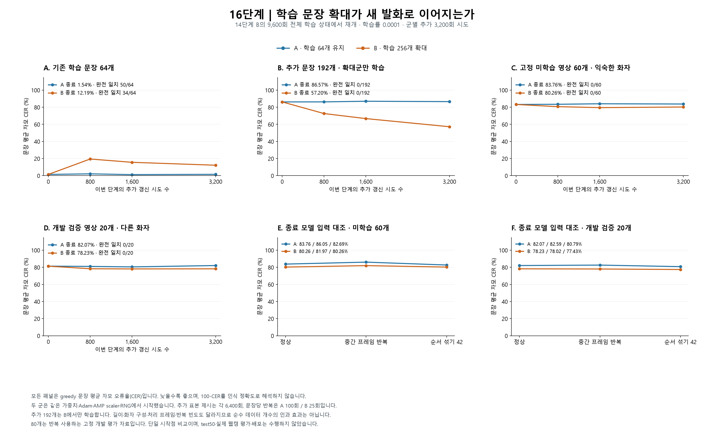

# 16단계 — 학습 자료 64개 유지와 256개 확대 비교

16단계를 완료했다. 256개 확대군은 64개 유지군보다 미학습 60개와 다른 화자의 개발 검증 20개에서 문장 평균 자모 오류율이 각각 3.50%p, 3.84%p 낮았다. 다만 두 군 모두 이 80문장의 완전 일치는 0개다. 확대군의 새 학습 192개도 CER 57.20%에 머물고, 기존 64개의 CER는 출발 1.43%에서 12.19%로 악화했다. 자료 확대의 제한적인 개선은 확인했지만 웹캠 발화를 문장으로 읽는 목표에는 아직 도달하지 못했다.

15단계에서는 학습 영상에 대한 낮은 오류율이 새 문장으로 이어지지 않았다. 이번에는 같은 모델·학습률·출발 상태에서 학습 문장을 64개로 유지하거나 256개로 늘렸을 때, 고정된 미학습 80문장의 오류가 어떻게 달라지는지 비교했다.

**미학습 영상의 정상 입력 결과**

주 지표는 greedy 디코딩의 문장 평균 자모 오류율(CER)이다. 정답과 출력을 Unicode NFD 자모로 분해해 문장별 편집거리 비율을 계산한 뒤 평균했다. 낮을수록 좋고 삽입 오류 때문에 100%를 넘을 수 있다. 1−CER를 프로그램의 인식 정확도로 해석하지 않는다. 아래 완전 일치는 정답 문장 전체가 같은 경우다.

| 상태 | 미학습 60개 CER / 완전 일치 | 개발 검증 20개 CER / 완전 일치 |
| --- | ---: | ---: |
| 공통 출발: 14단계 B | 83.24% / 0/60 | 81.35% / 0/20 |
| A: 64개 유지 | 83.76% / 0/60 | 82.07% / 0/20 |
| B: 256개 확대 | 80.26% / 0/60 | 78.23% / 0/20 |



**두 실험군의 공통 출발점과 달라진 자료**

- 14단계 B의 누적 9,600회 전체 학습 상태에서 시작했다. 가중치뿐 아니라 Adam의 모멘트·step, AMP GradScaler, Python·NumPy·PyTorch CPU/CUDA 난수 상태를 복원했다. 두 군의 학습률은 모두 0.0001이다.
- A는 기존 64개, B는 그 64개를 포함한 256개를 학습한다. 각 군은 batch 2로 추가 3,200회 갱신을 시도했다. 이 보고서의 로컬 0/800/1,600/3,200회는 누적 9,600/10,400/11,200/12,800회에 해당한다.
- 두 군 모두 새 로컬 데이터 순서 생성기(seed 42)를 사용했다. 전역 RNG·optimizer를 초기화한 것은 아니다. 학습 목록이 달라 배치 구성과 이후 학습 경로도 달라진다.
- 기존 compact 모델과 전처리를 유지했다. RGB 96×96·25fps 입술 영상의 시간 길이 T를 보존하고, 3D CNN → 프레임별 GroupNorm → 투영층 → 2층 양방향 LSTM → 69개 자모/공백/blank CTC 출력을 사용한다. 학습은 AMP와 FP32 CTC, 평가는 FP32·패딩 없는 batch 1이다.

**추가 192문장을 고른 기준**

- 15단계의 미학습 train60 및 기존 val20을 그대로 고정했다. train60의 37개 녹화에 속한 train 영상 383개를 전부 제외해 617개·59개 녹화가 남았다. 평가 정답과 NFC·공백 정규화 후 완전히 일치하는 문장도 제외하도록 했으며, 실제 추가 제외는 0개였다.
- 기존 64개를 원래 순서대로 보존하고 나머지 553개 중 192개를 골랐다. 예측 결과 없이 길이 구간을 번갈아 배정하고, 각 구간에서 SHA256으로 정한 화자·영상 순서로 선택했다. 선정 계획과 해시는 학습 전에 동결했다.
- 추가 192개의 길이 1–50 / 51–100 / 101–150 / 151–200프레임 구간은 4 / 63 / 63 / 62개다. 새로운 짧은 후보가 4개뿐인 제한을 반영했다. 확장 256개는 28 / 76 / 76 / 76개다.
- 화자는 두 군 모두 기존 8명이다. 학습 녹화는 A의 48개에서 B의 59개로 늘었다. 이 실험에서는 새로운 학습 화자를 추가하지 않았다.
- 기존 64개는 두 군 모두 이미 학습한 자료다. 추가 192개는 A에서는 학습하지 않은 진단 표본이지만, B에서는 이번 단계의 학습 자료다. 따라서 B의 추가 192개 성과를 일반화 성능으로 표시하지 않는다.

**정상 영상의 학습 진행 결과**

각 셀은 문장 평균 CER / 완전 일치 수다. 네 시점을 미리 고정했으며 개발 검증 점수로 중간 가중치를 선택하거나 학습을 조기 종료하지 않았다. 0회는 두 군의 전체 출력이 같아 한 행으로 표시했다.

| 군 / 로컬 갱신 시도 | 기존 64개 | 추가 192개 | 미학습 60개 | 개발 검증 20개 |
| --- | ---: | ---: | ---: | ---: |
| 공통 출발 / 0 | 1.43% / 49/64 | 86.20% / 0/192 | 83.24% / 0/60 | 81.35% / 0/20 |
| A: 64개 유지 / 800 | 2.10% / 51/64 | 86.25% / 0/192 | 83.45% / 0/60 | 81.04% / 0/20 |
| A: 64개 유지 / 1,600 | 1.22% / 53/64 | 86.99% / 0/192 | 84.05% / 0/60 | 80.48% / 0/20 |
| A: 64개 유지 / 3,200 | 1.54% / 50/64 | 86.57% / 0/192 | 83.76% / 0/60 | 82.07% / 0/20 |
| B: 256개 확대 / 800 | 19.46% / 26/64 | 72.61% / 0/192 | 80.67% / 0/60 | 78.31% / 0/20 |
| B: 256개 확대 / 1,600 | 15.60% / 31/64 | 66.72% / 0/192 | 79.53% / 0/60 | 78.11% / 0/20 |
| B: 256개 확대 / 3,200 | 12.19% / 34/64 | 57.20% / 0/192 | 80.26% / 0/60 | 78.23% / 0/20 |

확대군 B는 로컬 1,600→3,200회 동안 새 학습 192개의 CER가 66.72%→57.20%로 줄었지만, 미학습 60개는 79.53%→80.26%, 개발 검증 20개는 78.11%→78.23%로 소폭 악화했다. 따라서 학습 문장 적합도 향상이 새 문장의 개선으로 계속 이어진다고 볼 수 없다. 기존 64개의 완전 일치도 출발 49개에서 B 종료 34개로 줄었다. 새 자료 적응과 기존 문장 유지의 상충이 관찰되지만, 반복 횟수 차이 등 여러 요인이 있어 원인을 하나로 확정하지 않는다.

**같은 문장끼리 비교한 변화**

아래 CER 변화는 뒤 상태−앞 상태이며 음수가 오류 감소다. 서로 다른 집단의 평균끼리 뺀 값이 아니다.

| 비교 | 집단 | 개선 / 동일 / 악화 문장 수 | 평균 CER 변화(%p) |
| --- | --- | ---: | ---: |
| 출발 → A 종료 | 기존 학습 64개 | 10 / 47 / 7 | +0.11 |
| 출발 → A 종료 | 추가 후보 192개 | 74 / 32 / 86 | +0.36 |
| 출발 → A 종료 | 익숙한 화자의 미학습 60개 | 25 / 7 / 28 | +0.53 |
| 출발 → A 종료 | 다른 화자의 개발 검증 20개 | 4 / 8 / 8 | +0.72 |
| 출발 → B 종료 | 기존 학습 64개 | 1 / 35 / 28 | +10.75 |
| 출발 → B 종료 | 추가 후보 192개 | 189 / 3 / 0 | -29.01 |
| 출발 → B 종료 | 익숙한 화자의 미학습 60개 | 36 / 7 / 17 | -2.98 |
| 출발 → B 종료 | 다른 화자의 개발 검증 20개 | 15 / 1 / 4 | -3.12 |
| A 종료 → B 종료 | 기존 학습 64개 | 1 / 35 / 28 | +10.64 |
| A 종료 → B 종료 | 추가 후보 192개 | 190 / 2 / 0 | -29.37 |
| A 종료 → B 종료 | 익숙한 화자의 미학습 60개 | 39 / 8 / 13 | -3.50 |
| A 종료 → B 종료 | 다른 화자의 개발 검증 20개 | 14 / 3 / 3 | -3.84 |

**정지 영상·순서 섞기 대조와 beam 디코딩**

대조 입력은 미학습 60개와 개발 검증 20개에만 출발·종료 시점에 적용했다. 중간 프레임 반복은 정지된 입모양을 원래 길이 T만큼 반복하고, 순서 섞기는 영상 ID와 seed 42로 고정한 같은 순열을 두 군에 적용한다. 정상 입력이 더 좋아지는지 확인하되, 출력의 변화 자체를 정확한 입술 움직임 인식의 증거로 삼지 않는다.

| 상태 / 집단 | 정상 CER | 중간 프레임 반복 CER | 순서 섞기 CER |
| --- | ---: | ---: | ---: |
| 공통 출발: 14단계 B / 익숙한 화자의 미학습 60개 | 83.24% | 85.17% | 82.93% |
| 공통 출발: 14단계 B / 다른 화자의 개발 검증 20개 | 81.35% | 81.77% | 80.26% |
| A: 64개 유지 / 익숙한 화자의 미학습 60개 | 83.76% | 86.05% | 82.69% |
| A: 64개 유지 / 다른 화자의 개발 검증 20개 | 82.07% | 82.59% | 80.79% |
| B: 256개 확대 / 익숙한 화자의 미학습 60개 | 80.26% | 81.97% | 80.26% |
| B: 256개 확대 / 다른 화자의 개발 검증 20개 | 78.23% | 78.02% | 77.43% |

B 종료에서 미학습 60개의 정상/순서 섞기 CER는 80.26%/80.26%로 사실상 같았다. 개발 검증 20개는 정상 78.23%보다 정지 78.02%, 순서 섞기 77.43%가 오히려 낮았다. 문장별 비율의 평균을 쓰는 이번 주 지표는 정상적인 시간 순서의 일관된 우위를 보여주지 못했다. 다만 전체 편집거리 합을 정답 자모 수 합으로 나눈 corpus CER에서는 B의 정상 입력이 두 평가 집단 모두 두 대조보다 낮아, 집계 방식에 따라 순위가 달라진다. 움직임 정보를 전혀 사용하지 않는다고 단정할 수는 없지만, 시간에 따른 입술 움직임을 정확한 새 문장으로 해독한다는 증거도 부족하다.

beam width 10은 정상 입력 336개 전체에 출발·종료 시점만 적용했다. 주 지표는 계속 greedy이며, beam 지표는 디코더 변경만으로 차이가 나는지 보는 보조 결과다.

| 상태 | 기존 64개 beam CER / 일치 | 추가 192개 beam CER / 일치 | 미학습 60개 beam CER / 일치 | 개발 검증 20개 beam CER / 일치 |
| --- | ---: | ---: | ---: | ---: |
| 공통 출발: 14단계 B | 1.39% / 49/64 | 86.17% / 0/192 | 83.24% / 0/60 | 81.05% / 0/20 |
| A: 64개 유지 | 1.51% / 51/64 | 86.40% / 0/192 | 83.75% / 0/60 | 82.13% / 0/20 |
| B: 256개 확대 | 12.10% / 35/64 | 57.06% / 0/192 | 80.10% / 0/60 | 78.11% / 0/20 |

B 종료의 beam CER는 미학습 60개 80.10%, 개발 검증 20개 78.11%로 greedy보다 약간 낮지만, 두 집단의 완전 일치는 여전히 0개다. 이번 beam 폭 변경만으로 핵심 문제가 해결되지는 않았다.

**미학습 영상의 출력 확률**

| 상태 / 집단 | 정답 토큰당 CTC loss | 평균 blank 확률 | greedy 출력 토큰 종류 |
| --- | ---: | ---: | ---: |
| 공통 출발: 14단계 B / 익숙한 화자의 미학습 60개 | 5.6790 | 42.37% | 48 |
| 공통 출발: 14단계 B / 다른 화자의 개발 검증 20개 | 6.1269 | 44.10% | 39 |
| A: 64개 유지 / 익숙한 화자의 미학습 60개 | 6.3403 | 41.64% | 48 |
| A: 64개 유지 / 다른 화자의 개발 검증 20개 | 6.7274 | 43.53% | 40 |
| B: 256개 확대 / 익숙한 화자의 미학습 60개 | 3.6420 | 41.60% | 47 |
| B: 256개 확대 / 다른 화자의 개발 검증 20개 | 3.6456 | 45.22% | 35 |

문장별 CER·WER, 길이별·화자별 결과, 출력 토큰 분포는 [검증 JSON](16_검증결과.json)에 저장했다. [고정 80문장의 전체 출력](16_문장별_출력.md)은 출발 모델과 종료 A/B의 정상 greedy 출력을 모두 기록한다. 추가 192개를 포함한 전체 336개의 정상 greedy·beam 문자열은 JSON의 `normal_predictions`에 있다.

**같은 갱신 횟수와 실제 계산량의 차이**

두 군 모두 3,200회 × batch 2 = 6,400회 영상 제시지만 A는 문장당 100회, B는 25회다. 원래 64개는 13·14단계 구간에서 이미 각 300회의 제시 이력을 공유하며, 그중 짧은 16개에는 더 이른 선행 학습도 있다. 추가 192개는 출발 가중치의 학습 이력에 없었다. 길이 분포와 패딩도 달라 같은 갱신 횟수가 같은 FLOPs나 실행 시간을 뜻하지 않는다.

| 군 | 시도 영상 제시 | 패딩 전 프레임 제시 | 패딩 포함 프레임 제시 | 패딩 비율 | 학습 시도 시간(초) |
| --- | ---: | ---: | ---: | ---: | ---: |
| A: 64개 유지 | 6,400 | 599,500 | 791,236 | 24.23% | 507.1 |
| B: 256개 확대 | 6,400 | 744,625 | 916,054 | 18.71% | 520.2 |

프레임 제시 수는 telemetry에서 합산한 작업량 지표이며 FLOPs 실측값은 아니다. AMP overflow로 optimizer 갱신이 생략된 시도도 forward/backward와 자료 제시를 수행하므로 시도 예산에 포함했다.

| 군 | 로컬 성공 / 생략 | 누적 성공 / 생략 | 종료 scaler | 평가·저장 포함 군 실행 시간(초) | GPU 최대 할당 / 예약(MiB) |
| --- | ---: | ---: | ---: | ---: | ---: |
| A: 64개 유지 | 3,199 / 1 | 12,798 / 2 | 16384 | 786.5 | 715.1 / 1488.0 |
| B: 256개 확대 | 3,198 / 2 | 12,797 / 3 | 4096 | 829.6 | 760.1 / 1778.0 |

| 군 | 기존 64개 시도 / 성공 제시 범위 | 추가 192개 시도 / 성공 제시 범위 |
| --- | ---: | ---: |
| A: 64개 유지 | 100–100 / 99–100 | 0–0 / 0–0 |
| B: 256개 확대 | 25–25 / 24–25 | 25–25 / 24–25 |

생략된 시도는 다음과 같으며, 계획된 배치를 다시 넣거나 예산을 연장하지 않았다.

| 군 | 로컬 / 누적 시도 | 배치 ID | loss | scaler 변화 |
| --- | ---: | --- | ---: | ---: |
| A: 64개 유지 | 2523 / 12123 | `lip_J_1_F_02_C004_A_011_043`, `lip_J_1_F_03_C293_A_007_019` | 0.204582 | 32768 → 16384 |
| B: 256개 확대 | 25 / 9625 | `lip_J_1_F_03_C297_A_012_005`, `lip_J_1_F_02_C002_A_012_011` | 4.040875 | 8192 → 4096 |
| B: 256개 확대 | 65 / 9665 | `lip_J_1_F_03_C297_A_006_005`, `lip_J_1_F_02_C017_A_006_028` | 5.939998 | 4096 → 2048 |

**실행과 독립 검증**

- 실제 학습·평가 전체 실행 시간은 1858.2초였다. 위 학습 시도 시간과 군별 시간은 집계 범위가 다르며, 전체에는 사전 상태 복원·출발 평가·검사가 포함된다. 이후 독립 재계산과 문서 작업 시간은 제외한다.
- 어느 군도 학습하기 전에 두 군의 출발 전체 상태를 공통 출발 파일과 비교했다. 기존 64개 정상 출력 64개와 미학습 80개의 세 조건 출력 240개를 과거 저장 확률과 정확히 비교했고, 추가 192개를 포함한 출발 출력도 두 군에서 같았다.
- 고정 시점의 posterior 3,328개에서 greedy·CTC loss·확률/토큰 통계와 대조 차이를 다시 계산했다. 정상 beam 1,344개는 저장 문자열을 재채점하는 데 그치지 않고 다시 디코딩해 일치를 확인했다. 합계는 출발·종료 각 496개, 중간 각 336개의 두 군 평가로 구성된다.
- 두 군 × 네 시점의 전체 학습 상태 8개를 검사했다. 가중치를 해당 추론 체크포인트와 비교하고 Adam step·scaler·로컬/누적 계수·샘플 제시 횟수를 telemetry와 대조했다. 출발의 모멘트와 RNG는 원본과 직접 비교했고, 이후 저장 모멘트/RNG는 구조와 해시를 검사했다. 모든 갱신을 다시 학습해 재현한 것은 아니다.
- 각 평가가 가중치·optimizer·scaler·난수·학습 모드·backend 설정을 보존했는지는 실행기의 전체 상태 비교 기록으로 확인했다. 독립 재계산은 모델 forward나 optimizer replay를 수행하지 않는다. 캐시 해시·라벨·변환 인덱스를 검증했으며, 변경 픽셀 수는 범위 검사다.
- 선정 28개, 실행 50개, 재계산·변조 검출 65개, 총 **143개 테스트가 통과**했다. 각 JUnit 결과에 실패·오류·생략이 없는지 확인했다. 전체 프로젝트의 모든 회귀 검사를 뜻하지는 않는다.
- 개발 검증에 따른 best 가중치 선정·체크포인트 교체·test50 캐시 접근·웹캠 평가·서비스 배포를 수행하지 않았다. 새 파일은 진단용 `smoke_only` 상태이며 기존 서비스의 차단 규칙을 유지했다.

**해석 범위와 다음 17단계**

이번 비교에서는 학습 문장 수와 함께 문장 내용·길이·녹화 분포·반복 빈도·실제 계산량이 달라졌다. 한 가중치 계보와 한 seed의 결과여서 순수한 데이터 수의 인과 효과나 여러 seed에서의 재현성을 확정하지 않는다. train60은 익숙한 화자의 다른 녹화에서 뽑은 개발 진단 표본이고, val20도 이전 단계에서 사용한 개발 자료다. 두 집단은 내용과 길이도 달라 순수한 화자 효과를 분리하지 못하며, 실제 웹캠 성능을 측정한 결과가 아니다.

다음 17단계는 **256개 유지 추가 학습과 512개 확대를 같은 예산으로 비교**하는 실험을 권한다. 새 학습 192개의 오류율은 계속 줄었지만 미학습 성능은 후반에 정체했으므로, 더 많은 반복과 더 많은 문장 중 어느 방향이 도움이 되는지 대조군을 두고 확인하려는 목적이다. 두 군 모두 16단계 B 종료 전체 상태(`results/step16-diversity/run01/B_expand256/training_state_3200.pt`)에서 시작한다. 파일명의 3,200은 이번 단계의 로컬 시도 수이며 누적 시도는 12,800회다. 이어 학습할 때는 이전 단계 이력과 실제 Adam step을 함께 보존해야 한다.

제안 조건은 동일 모델·학습률 0.0001·batch 2·각 군 추가 6,400회 시도다. 256개 유지군은 문장당 50회, 512개 확대군은 25회 추가 제시한다. 기존 617개 후보에서 현재 256개를 보존하고 미선택 361개 중 256개를 추가할 수 있다. 평가 80개와 그 녹화·정규화 정답 제외 규칙은 유지하고, 학습 전에 선정 목록·해시·순서·평가 시점(로컬 0/1,600/3,200/6,400회)을 동결한다. 종료 결과를 기준으로 새 자료 적합도·기존 문장 유지·고정 미학습 CER와 완전 일치, 정지/순서 섞기 대조를 함께 비교한다. 개발 점수로 중간 최고 가중치를 골라 성과로 발표하지 않는다.

이 제안에서도 학습 화자는 같은 8명이며, 반복 빈도와 프레임 계산량이 달라 순수한 문장 수 효과를 분리하지 못한다. 성능 향상을 보장하는 처방이 아니다. 학습 자료의 오류만 줄고 미학습 문장과 정상 시간 순서의 이점이 개선되지 않는다면 반복 예산만 계속 늘리지 않고, 다음에는 영상 특징 학습 방식·일반화 방법·더 다양한 화자 자료를 별도로 검토해야 한다.

17단계 작업은 아직 실행하지 않았다. 이번 16단계는 기존 캐시로 완료했으며 추가 데이터 다운로드가 필요하지 않았다. 향후 학습 자료가 더 필요해지면 필요한 자료와 이유를 먼저 안내한다.

**산출물과 재현 명령**

- [동결 계획과 학습·평가 목록](../../results/step16-diversity/run01/plan.json)
- [완료 기록](../../results/step16-diversity/run01/completed.json)
- [출발 복원 검증](../../results/step16-diversity/run01/preflight_gate.json)
- [별도 전체 학습 상태 검증](../../results/step16-diversity/run01/independent_state_audit.json)
- [캐시 접근 기록](../../results/step16-diversity/run01/cache_audit.json)
- [검증 결과 JSON](16_검증결과.json) · [80문장 전체 출력](16_문장별_출력.md)
- [학습 실행 코드](../../scripts/diagnose_training_diversity.py) · [선정 코드](../../scripts/diversity_selection.py)
- [독립 재계산 코드](../../scripts/summarize_training_diversity.py) · [그래프 코드](../../scripts/plot_training_diversity.py)

```powershell
$env:OMP_NUM_THREADS='2'
$env:MKL_NUM_THREADS='2'
.venv-gpu/Scripts/python.exe scripts/diagnose_training_diversity.py --out results/step16-diversity/run02
.venv-gpu/Scripts/python.exe scripts/summarize_training_diversity.py --run results/step16-diversity/run01 --out tmp/step16-recheck.json
```

첫 명령은 재현이 필요할 때만 실행하며 새 결과 폴더에 두 군을 다시 학습한다. 두 번째 명령은 기존 저장 확률과 학습 상태를 재검증하며 모델 추론·학습은 하지 않는다.
