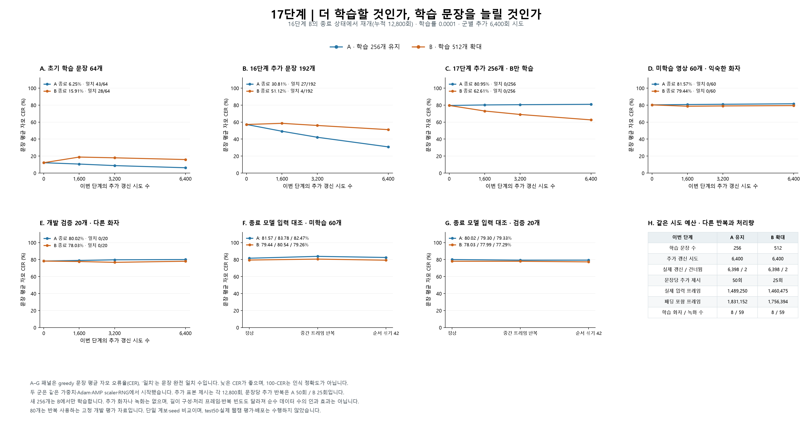

# 17단계 — 256개 추가 학습과 512개 자료 확대 비교

> **2026-09-24 후속 점검:** 아래 val20의 C025 발화 구간에서 라벨/영상 시간 불일치가 확인됐다. 새 계획 5단계에서 원래 입력·출력의 정확 재현 후 같은 최종 A/B 가중치를 시간 보정된20문장으로 재평가했으며, 두 모델 모두 완성형 문자 CER84.56%·완전 일치0/20이었다. 아래17단계 수치는 당시 조건의 기록이며 자모 CER와 새 완성형 문자 CER를 혼동하지 않는다. 실제 학습59녹화와 train60의 시간축은 아직 별도 감사가 필요하다. [교정 후 재평가](../공식모델_도입검증/05_실행결과.md).

17단계를 완료했다. 512개 확대군은 256개 유지군보다 고정 미학습 두 집단의 문장 평균 CER가 낮았지만, 출발점 대비 개선은 약 0.81·0.20%포인트에 그쳤다. 평가 80문장의 완전 일치는 여전히 0개이며, 정상 프레임 순서의 이점도 일관되지 않았다. 같은 자료의 추가 반복이나 같은 녹화 안의 문장 확대만으로 웹캠 문장 인식 목표에 도달하지 못했다.

16단계에 이어 같은 256개를 더 학습하는 방향과 512개로 문장을 늘리는 방향을 비교했다. 이번 단계의 목적은 학습 자료 적합도, 이미 배운 문장의 유지, 고정된 미학습 문장으로의 전이를 함께 확인하는 것이다.

**미학습 영상의 정상 입력 결과**

주 지표는 greedy 디코딩의 문장 평균 자모 오류율(CER)이다. 정답과 출력을 Unicode NFD 자모로 분해해 문장별 편집거리 비율을 구한 뒤 평균했다. 낮을수록 좋고 삽입 오류 때문에 100%를 넘을 수 있다. 1−CER를 프로그램의 인식 정확도로 환산하지 않는다. 완전 일치는 정답 문장 전체가 같은 경우다.

| 상태 | 미학습 60개 CER / 완전 일치 | 개발 검증 20개 CER / 완전 일치 |
| --- | ---: | ---: |
| 공통 출발: 16단계 B | 80.26% / 0/60 | 78.23% / 0/20 |
| A: 256개 유지 | 81.57% / 0/60 | 80.02% / 0/20 |
| B: 512개 확대 | 79.44% / 0/60 | 78.03% / 0/20 |



**공통 출발 상태와 학습 이력의 연결**

두 군 모두 16단계 B의 `training_state_3200.pt`에서 가중치·Adam 모멘트와 step·AMP GradScaler·Python/NumPy/PyTorch CPU/CUDA RNG를 복원했다. 이 파일의 3,200회는 16단계 로컬 시도 수이며 누적 12,800회와 구분해야 한다. 저장된 로컬 계수에 앞 단계 이력을 합쳐 누적 이력을 복원하고, optimizer 안의 실제 Adam step은 초기화하거나 파일명의 숫자로 덮어쓰지 않았다.

공통 출발의 누적 optimizer 성공은 12,797회, 생략은 3회다. A는 기존 256개를 유지하고 B는 512개로 확대했다. 학습률 0.0001·batch 2·추가 6,400회 시도 예산은 같다. 17단계의 로컬 0 / 1,600 / 3,200 / 6,400회는 누적 12,800 / 14,400 / 16,000 / 19,200회에 해당한다.

자료 순서는 두 군 모두 새 로컬 seed 42 생성기로 사전 계산했다. 전역 RNG와 optimizer를 초기화한 것은 아니다. 목록과 배치 구성이 달라 이후 학습 경로는 달라진다. 기존 compact 구조와 전처리는 유지했다. RGB 96×96·25fps 입술 영상의 T를 보존하고 3D CNN → 프레임별 GroupNorm → 투영층 → 2층 양방향 LSTM → 69개 자모/공백/blank CTC 출력을 사용한다. 학습은 AMP와 FP32 CTC, 평가는 FP32·패딩 없는 batch 1이다.

**새 256문장과 고정 평가 자료**

- 기존 original64와 16단계 additional192를 그 순서 그대로 보존했다. 15단계부터 사용한 train60의 37개 녹화 전체 383문장을 학습에서 제외했고, 고정 val20도 학습에 사용하지 않았다. 평가 정답과 NFC·공백 정규화 후 완전히 같은 문장도 제외하도록 했으며 실제 추가 제외는 0개였다.
- 617개 학습 후보 가운데 기존 256개를 제외한 361개에서 새 256개를 골랐다. 예측을 사용하지 않고 동결된 16단계 길이·화자 순환 정책과 SHA256 정렬 규칙을 재사용했다. 선정 목록·계획·해시는 학습 전에 고정했다.
- 추가 256개의 길이 1–50 / 51–100 / 101–150 / 151–200프레임 구간은 0 / 111 / 111 / 34개다. 총 512개는 28 / 187 / 187 / 110개다. 짧은 구간의 새 후보가 없고 가장 긴 구간의 남은 34개를 모두 포함하므로 길이 분포가 균등하지 않다.
- 학습 화자 8명과 녹화 59개는 두 군에서 같다. 새 256개 자체는 58개 녹화에 걸쳐 있지만, 이미 기존 256개에 포함된 녹화들이므로 새로운 화자나 녹화를 추가한 실험은 아니다.
- 초기 64개와 16단계 추가 192개는 두 군 모두의 학습 자료다. 17단계 추가 후보 256개는 A에서는 학습하지 않은 진단 표본이고 B에서는 학습 자료다. B가 이 256개를 더 잘 맞추는 것과 고정 80개에서의 일반화 개선을 구분한다. A의 새 256개는 기존 학습과 녹화를 공유하므로, 녹화까지 분리한 train60과도 다르다.

**고정 시점의 정상 영상 결과**

각 셀은 문장 평균 CER / 완전 일치 수다. 출발·중간 두 번·종료의 네 시점을 미리 정했고, 검증 점수로 중간 가중치를 선택하거나 조기 종료하지 않았다. 출발 전체 출력은 두 군에서 같아 한 행으로 표시했다.

| 군 / 로컬 시도 | 초기 64개 | 16단계 추가 192개 | 17단계 추가 후보 256개 | 미학습 60개 | 개발 검증 20개 |
| --- | ---: | ---: | ---: | ---: | ---: |
| 공통 출발 / 0 | 12.19% / 34/64 | 57.20% / 0/192 | 79.58% / 0/256 | 80.26% / 0/60 | 78.23% / 0/20 |
| A: 256개 유지 / 1,600 | 10.60% / 35/64 | 49.23% / 3/192 | 80.20% / 0/256 | 80.69% / 0/60 | 78.93% / 0/20 |
| A: 256개 유지 / 3,200 | 8.77% / 38/64 | 42.13% / 11/192 | 80.50% / 0/256 | 81.00% / 0/60 | 79.72% / 0/20 |
| A: 256개 유지 / 6,400 | 6.25% / 43/64 | 30.81% / 27/192 | 80.95% / 0/256 | 81.57% / 0/60 | 80.02% / 0/20 |
| B: 512개 확대 / 1,600 | 18.83% / 26/64 | 58.54% / 0/192 | 73.06% / 0/256 | 78.69% / 0/60 | 77.70% / 0/20 |
| B: 512개 확대 / 3,200 | 17.95% / 28/64 | 56.03% / 1/192 | 68.98% / 0/256 | 79.03% / 0/60 | 76.75% / 0/20 |
| B: 512개 확대 / 6,400 | 15.91% / 28/64 | 51.12% / 4/192 | 62.61% / 0/256 | 79.44% / 0/60 | 78.03% / 0/20 |

A는 16단계 추가 192개의 CER가 57.20%에서 30.81%로 낮아졌지만, 고정 미학습 60개와 개발 검증 20개는 모두 출발점보다 악화됐다. 훈련 문장을 더 잘 맞추는 것과 미학습 문장으로 일반화하는 것이 분리된 결과다. B는 종료 시 A보다 각각 2.12·1.99%포인트 낮았지만, 출발점보다 낮아진 폭은 각각 0.81·0.20%포인트로 작았다. A와의 차이에는 A의 악화도 포함된다.

B에서도 3,200→6,400회 사이 새 256개의 학습 CER는 68.98%→62.61%로 개선됐으나, 고정 미학습 두 집단의 CER와 정답 토큰당 CTC loss는 모두 악화됐다. 사전에 정한 종료점을 보고한 것이며 중간 점수를 보고 종료점을 바꾸거나 3,200회 모델을 배포 대상으로 고른 것은 아니다. 초기 64개는 출발 CER 12.19%·완전 일치 34개에서 B 종료 15.91%·28개로 후퇴했다. 동일 시도 예산에서 기존 문장의 반복 빈도가 절반이 된 확대의 유지 성능도 함께 고려해야 한다.

보조 지표인 corpus CER는 문장별 평균 대신 전체 정답 자모 수로 전체 편집거리를 나눈다. B의 출발→종료는 train60에서 79.48%→78.51%로 낮아졌지만, val20에서는 76.87%→78.12%로 오히려 높아졌다. val20의 작은 개선은 문장 평균 지표에 한정되며, 집계 방식에 걸쳐 일관된 개선으로 볼 수 없다.

**같은 문장끼리 비교한 변화**

CER 변화는 뒤 상태−앞 상태이며 음수가 개선이다. 서로 다른 문장 집단의 평균을 직접 뺀 값이 아니다.

| 비교 | 집단 | 개선 / 동일 / 악화 문장 수 | 평균 CER 변화(%p) |
| --- | --- | ---: | ---: |
| 출발 → A 종료 | 초기 학습 64개 | 26 / 36 / 2 | -5.94 |
| 출발 → A 종료 | 16단계 추가 192개 | 191 / 1 / 0 | -26.39 |
| 출발 → A 종료 | 17단계 추가 후보 256개 | 85 / 33 / 138 | +1.37 |
| 출발 → A 종료 | 익숙한 화자의 미학습 60개 | 20 / 9 / 31 | +1.31 |
| 출발 → A 종료 | 다른 화자의 개발 검증 20개 | 5 / 3 / 12 | +1.79 |
| 출발 → B 종료 | 초기 학습 64개 | 5 / 31 / 28 | +3.72 |
| 출발 → B 종료 | 16단계 추가 192개 | 144 / 9 / 39 | -6.08 |
| 출발 → B 종료 | 17단계 추가 후보 256개 | 243 / 4 / 9 | -16.97 |
| 출발 → B 종료 | 익숙한 화자의 미학습 60개 | 28 / 12 / 20 | -0.81 |
| 출발 → B 종료 | 다른 화자의 개발 검증 20개 | 10 / 1 / 9 | -0.20 |
| A 종료 → B 종료 | 초기 학습 64개 | 0 / 29 / 35 | +9.66 |
| A 종료 → B 종료 | 16단계 추가 192개 | 1 / 5 / 186 | +20.31 |
| A 종료 → B 종료 | 17단계 추가 후보 256개 | 251 / 3 / 2 | -18.34 |
| A 종료 → B 종료 | 익숙한 화자의 미학습 60개 | 34 / 8 / 18 | -2.12 |
| A 종료 → B 종료 | 다른 화자의 개발 검증 20개 | 10 / 3 / 7 | -1.99 |

**정지·순서 섞기 대조와 beam 디코딩**

정지·순서 섞기 대조는 고정 미학습 60개와 개발 검증 20개에 출발·종료 시점만 적용했다. 정지 조건은 중간 프레임을 원래 T만큼 반복한다. 섞기 조건은 영상 ID와 seed 42로 정한 동일 순열을 공통 적용한다. 출력이 바뀌는 것만으로 정확한 입술 움직임 인식을 입증하지는 못한다.

| 상태 / 집단 | 정상 CER | 중간 프레임 반복 CER | 순서 섞기 CER |
| --- | ---: | ---: | ---: |
| 공통 출발: 16단계 B / 익숙한 화자의 미학습 60개 | 80.26% | 81.97% | 80.26% |
| 공통 출발: 16단계 B / 다른 화자의 개발 검증 20개 | 78.23% | 78.02% | 77.43% |
| A: 256개 유지 / 익숙한 화자의 미학습 60개 | 81.57% | 83.78% | 82.47% |
| A: 256개 유지 / 다른 화자의 개발 검증 20개 | 80.02% | 79.30% | 79.33% |
| B: 512개 확대 / 익숙한 화자의 미학습 60개 | 79.44% | 80.54% | 79.26% |
| B: 512개 확대 / 다른 화자의 개발 검증 20개 | 78.03% | 77.99% | 77.29% |

beam width 10은 정상 입력 592개 전체에 출발·종료 시점만 적용했다. 주 지표는 greedy이며 beam은 디코딩 방식에 따른 보조 비교다.

| 상태 | 초기 64개 beam CER / 일치 | 16단계 추가 192개 | 17단계 추가 후보 256개 | 미학습 60개 | 개발 검증 20개 |
| --- | ---: | ---: | ---: | ---: | ---: |
| 공통 출발: 16단계 B | 12.10% / 35/64 | 57.06% / 0/192 | 79.62% / 0/256 | 80.10% / 0/60 | 78.11% / 0/20 |
| A: 256개 유지 | 6.16% / 43/64 | 30.76% / 27/192 | 80.83% / 0/256 | 81.56% / 0/60 | 80.10% / 0/20 |
| B: 512개 확대 | 15.80% / 28/64 | 50.89% / 4/192 | 62.47% / 0/256 | 79.28% / 0/60 | 77.88% / 0/20 |

주 지표인 문장 평균 CER에서 B 종료의 정상 입력은 두 평가 집단 모두 순서 섞기보다 좋지 않았고, val20에서는 정지 입력보다도 약간 높았다. 이는 현재 고정 평가에서 올바른 시간 순서의 인식 이점이 안정적으로 확인되지 않았다는 뜻이다. 움직임을 전혀 사용하지 않는다거나 전처리에 오류가 있다는 증거로 확대 해석하지 않는다. 전체 정답 자모를 합산하는 corpus CER는 긴 문장의 영향이 더 크므로 문장 평균과 구분해 검증 JSON에 기록했다.

B 종료의 beam은 greedy보다 미학습 60개에서 약 0.17%포인트, val20에서 약 0.15%포인트 낮았고 완전 일치는 여전히 모두 0개였다. 디코딩 변경만으로 현재의 높은 오류율이 해결되지는 않았다.

**미학습 영상의 출력 확률**

| 상태 / 집단 | 정답 토큰당 CTC loss | 평균 blank 확률 | greedy 출력 토큰 종류 |
| --- | ---: | ---: | ---: |
| 공통 출발: 16단계 B / 익숙한 화자의 미학습 60개 | 3.6420 | 41.60% | 47 |
| 공통 출발: 16단계 B / 다른 화자의 개발 검증 20개 | 3.6456 | 45.22% | 35 |
| A: 256개 유지 / 익숙한 화자의 미학습 60개 | 4.0811 | 41.15% | 44 |
| A: 256개 유지 / 다른 화자의 개발 검증 20개 | 4.1192 | 44.25% | 38 |
| B: 512개 확대 / 익숙한 화자의 미학습 60개 | 3.3875 | 42.23% | 40 |
| B: 512개 확대 / 다른 화자의 개발 검증 20개 | 3.3506 | 45.10% | 31 |

문장별 CER·WER, 길이별·화자별 결과, 출력 토큰 분포는 [검증 JSON](17_검증결과.json)에 저장했다. [고정 80문장 전체 출력](17_문장별_출력.md)은 출발 모델과 종료 A/B의 정상 greedy 결과를 빠짐없이 기록한다. 새 학습 후보까지 포함한 전체 592개의 정상 greedy·beam 문자열은 JSON의 `normal_predictions`에 있다.

**반복 빈도와 실제 계산량**

두 군 모두 6,400회 × batch 2 = 12,800회 영상 제시를 수행한다. 기존 256개는 A에서 문장당 50회, B의 전체 512개는 문장당 25회 추가 제시된다. 추가 후보 256개는 A에서 0회다. 길이 분포·패딩·반복 빈도가 달라 같은 갱신 예산이 같은 계산량이나 순수한 자료 수 효과를 뜻하지 않는다.

| 집단 | 공통 출발의 누적 시도 제시 범위 | 공통 출발의 성공 제시 범위 |
| --- | ---: | ---: |
| 초기 학습 64개 | 325–325 | 324–325 |
| 16단계 추가 192개 | 25–25 | 24–25 |
| 17단계 추가 후보 256개 | 0–0 | 0–0 |

초기 64개 안의 짧은 16개에는 위 계수 이전의 선행 초기화 학습도 있다. 위 표는 저장된 단계별 이력을 연결한 제시 계수이며 학습 이력 전체를 모두 같은 횟수로 본다는 의미가 아니다.

| 군 | 시도 영상 제시 | 패딩 전 프레임 제시 | 패딩 포함 프레임 제시 | 패딩 비율 | 학습 시도 시간(초) |
| --- | ---: | ---: | ---: | ---: | ---: |
| A: 256개 유지 | 12,800 | 1,489,250 | 1,831,152 | 18.67% | 1000.8 |
| B: 512개 확대 | 12,800 | 1,460,475 | 1,756,394 | 16.85% | 979.6 |

프레임 제시 수는 telemetry에서 합산한 작업량 지표이며 FLOPs 실측값은 아니다. AMP overflow로 optimizer 갱신이 생략된 시도도 forward/backward와 자료 제시를 수행하므로 시도 예산에 포함했다.

| 군 | 로컬 성공 / 생략 | 누적 성공 / 생략 | 종료 scaler | 평가·저장 포함 군 실행 시간(초) | GPU 최대 할당 / 예약(MiB) |
| --- | ---: | ---: | ---: | ---: | ---: |
| A: 256개 유지 | 6,398 / 2 | 19,195 / 5 | 8192 | 1593.2 | 760.2 / 1770.0 |
| B: 512개 확대 | 6,398 / 2 | 19,195 / 5 | 4096 | 1547.7 | 760.1 / 3014.0 |

| 군 | 초기 64개 시도 / 성공 제시 범위 | 16단계 추가 192개 | 17단계 추가 후보 256개 |
| --- | ---: | ---: | ---: |
| A: 256개 유지 | 50–50 / 49–50 | 50–50 / 49–50 | 0–0 / 0–0 |
| B: 512개 확대 | 25–25 / 25–25 | 25–25 / 24–25 | 25–25 / 24–25 |

생략된 배치를 다시 넣거나 계획된 시도 예산을 연장하지 않았다.

| 군 | 로컬 / 누적 시도 | 배치 ID | loss | scaler 변화 |
| --- | ---: | --- | ---: | ---: |
| A: 256개 유지 | 1209 / 14009 | `lip_J_1_F_02_C004_A_010_043`, `lip_J_1_F_02_C002_A_004_036` | 1.370532 | 8192 → 4096 |
| A: 256개 유지 | 5921 / 18721 | `lip_J_1_F_02_C002_A_009_046`, `lip_J_1_F_02_C002_A_007_057` | 1.557959 | 16384 → 8192 |
| B: 512개 확대 | 234 / 13034 | `lip_J_1_F_02_C002_A_009_046`, `lip_J_1_F_03_C297_A_012_026` | 3.562415 | 4096 → 2048 |
| B: 512개 확대 | 5073 / 17873 | `lip_J_1_F_03_C312_A_003_002`, `lip_J_1_F_03_C282_A_007_030` | 2.294393 | 8192 → 4096 |

**실행과 독립 검증**

- 실제 학습·평가 전체 실행 시간은 3554.4초다. 학습 시도 시간·군별 시간과 집계 범위가 다르며 전체에는 사전 복원·출발 평가·검사가 포함된다. 이후 독립 재계산과 문서 작성 시간은 제외한다.
- 어느 군도 학습하기 전에 공통 출발 전체 상태를 원본과 직접 비교했다. 기존 학습 256개의 정상 출력과 고정 80개의 세 조건 출력, 합계 496개를 16단계 B 종료 posterior와 정확히 비교했다. 새 후보까지 포함한 592개 및 대조 조건의 출발 출력도 두 군 사이에 같았다.
- 저장 posterior 5,376개에서 greedy·CTC loss·확률/토큰 통계와 대조 차이를 다시 계산했다. 정상 beam 2,368개는 저장 문자열 채점뿐 아니라 확률에서 다시 디코딩해 일치를 확인했다. 두 군 각각 출발·종료 752개씩, 중간 두 시점 592개씩이다.
- 두 군 × 네 시점의 전체 학습 상태 8개를 검사했다. 각 가중치는 추론 체크포인트와 비교했고 Adam step·scaler·로컬/누적 성공과 생략·자료 제시 횟수는 telemetry와 대조했다. 출발 모멘트와 RNG는 원본과 직접 비교했고 이후 모멘트/RNG는 구조와 해시를 검사했다. 모든 갱신을 다시 학습한 것은 아니다.
- 평가가 가중치·optimizer·scaler·난수·학습 모드·backend 설정을 보존한 것은 실행기의 전체 상태 비교 기록으로 확인한다. 독립 감사는 모델 forward나 optimizer replay를 수행하지 않는다. 캐시 해시·라벨·변환 인덱스를 재검증하며 변경 픽셀 수는 범위 검사다.
- 선정 23개, 실행 70개, 재계산·변조 검출 79개, 총 **172개 테스트가 통과**했다. 실제 JUnit에서 실패·오류·생략이 없는지 확인했다. 전체 프로젝트의 모든 회귀 검사를 뜻하지는 않는다.
- 검증 점수로 best 가중치 선정·기존 체크포인트 교체·test50 캐시 접근·웹캠 평가·서비스 배포를 수행하지 않았다. 새 가중치는 진단용 `smoke_only`이며 기존 서비스의 배포 차단 규칙을 유지했다.

**해석 범위와 다음 18단계**

문장 수뿐 아니라 내용·길이 분포·반복 빈도·프레임 계산량이 달라진 한 seed의 비교다. 두 군은 같은 8명·59개 녹화 안에서 학습했으며, 새로운 화자·촬영 조건에 대한 개선을 직접 시험한 설계는 아니다. train60과 val20은 여러 개발 단계에서 이미 본 고정 진단 자료이며 최종 독립 시험이 아니다. 같은 녹화에서 잘라낸 문장을 모두 독립 표본으로 보지 않는다. 두 집단의 내용과 길이도 달라 순수 화자 효과를 분리하지 못한다.

다음 18단계는 새 화자·새 녹화의 Training 원본 영상과 대응 JSON 라벨을 확보하기 위한 수집 요건과 입력 검수 준비를 우선한다. 현재 확인한 로컬 Training 원본(TS1/TS10, TL1/TL10)에는 기존 학습 8명의 새 녹화나 별도의 새 학습 화자가 없었다. 나머지 두 화자는 기존 val로 남겨야 한다. 다른 각도나 같은 녹화의 추가 문장은 남아 있지만 화자·녹화 다양성을 늘리지는 않는다. 따라서 이 범위를 넓히는 학습에는 추가 자료가 필요하다. 우선 기존 train/val/test 화자와 겹치지 않는 새 Training 화자의 영상·JSON을 첫 검수용 소량 표본으로 준비하고, 메타데이터로 화자·녹화·정답 중복을 확인한 뒤 실제 FPS, 발화 구간, 입술 ROI와 추출 품질을 검수하는 순서가 적절하다. 새 자료를 학습에 넣기 전에 분할과 비교 계획을 고정하고 본 학습에 필요한 화자·녹화 수는 18단계 수집 요건에서 정한다. 기존 ROI 좌표 교정과 9단계 FPS 교정, 11·15~17단계 대조를 오류 징후 없이 반복하는 작업은 우선하지 않는다. 이번 결과만으로 데이터 부족을 유일 원인으로 확정하거나 새 자료만으로 해결된다고 단정할 수는 없으며, 모델 표현력·정규화 등의 영향은 별도 통제 비교가 필요하다.

18단계는 아직 실행하지 않았다. 이번 17단계는 기존 캐시로 완료했으며 추가 데이터 다운로드가 필요하지 않았다. 위 18단계 제안의 새 화자·녹화 학습을 위해서는 추가 Training 영상과 대응 JSON이 필요하다. 원본 구성과 분할 이력은 [2단계 자료 준비](02_화자분리_데이터준비.md) 및 [7단계 자료 확대](07_학습데이터_확대.md)를 참고한다. 로컬 자료 확인은 알려진 AIHub 폴더와 기존 색인의 메타데이터·Training TAR 파일명 범위이며 컴퓨터 전체를 검색한 결과는 아니다.

**산출물과 재현 명령**

- [동결 계획과 학습·평가 목록](../../results/step17-expansion/run01/plan.json)
- [완료 기록](../../results/step17-expansion/run01/completed.json)
- [출발 복원 검증](../../results/step17-expansion/run01/preflight_gate.json)
- [캐시 접근 기록](../../results/step17-expansion/run01/cache_audit.json)
- [저장 학습 상태의 별도 독립 감사](../../results/step17-expansion/run01/independent_state_audit.json)
- [검증 결과 JSON](17_검증결과.json) · [80문장 전체 출력](17_문장별_출력.md)
- [학습 실행 코드](../../scripts/diagnose_training_expansion.py) · [선정 코드](../../scripts/expansion_selection.py)
- [독립 재계산 코드](../../scripts/summarize_training_expansion.py) · [그래프 코드](../../scripts/plot_training_expansion.py)

```powershell
$env:OMP_NUM_THREADS='2'
$env:MKL_NUM_THREADS='2'
.venv-gpu/Scripts/python.exe scripts/diagnose_training_expansion.py --out results/step17-expansion/run02
.venv-gpu/Scripts/python.exe scripts/summarize_training_expansion.py --run results/step17-expansion/run01 --out tmp/step17-recheck.json
```

첫 명령은 재현이 필요할 때만 실행하며 새 결과 폴더에 두 군을 다시 학습한다. 두 번째 명령은 기존 저장 확률과 전체 학습 상태를 재검증하며 모델 추론·학습은 하지 않는다.
